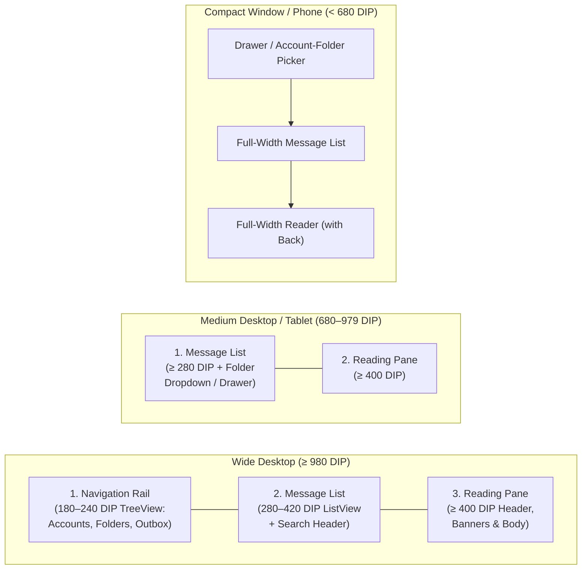

# Broiler Mail — Refined UI/UX Concept & Interaction Specification

**Version:** 1.0 (Post-M4 Consolidated Concept)  
**Date:** 26 November 2026  
**Status:** Implementation-ready authoritative UI/UX specification. Supersedes the 4-tab shell assumptions of [experience-roadmap.md](experience-roadmap.md) and [ui-implementation-roadmap.md](ui-implementation-roadmap.md), and unifies the user-facing interaction model across all M0–M4 capabilities in [product-completion-roadmap.md](product-completion-roadmap.md).  
**Review Rationale & Audit Evidence:** [Comprehensive Critical UI/UX Review (26 November 2026)](ui-ux-review-2026-11-26.md).  
**Detailed Task & Milestone Plan:** [Detailed UI/UX Refinement Roadmap (`UX-M0`–`UX-M6`)](ui-ux-roadmap.md).

---

## 1. Product Vision, Design Principles & Core Invariants

### 1.1 Product Vision
**Broiler Mail** is a calm, fast, privacy-respecting, offline-capable mail client built natively on `.NET 10`, `Broiler.UI`, and `Broiler.Graphics` (`NativeAOT`-first on desktop, shared portable core across Windows, Linux, Android, and `Broiler.Office`). It serves users who value **clarity, honesty about network and storage state, keyboard-first efficiency, and durable local ownership of their mail** without JavaScript execution, telemetry, or opaque background behavior.

### 1.2 Seven Governing UX Principles
1. **Context Over Modality:** Reading and writing mail are continuous spatial activities. Never cover the message being read or searched with a modal dialog for contextual actions (`Find`, `Zoom`, `HTML/Plain text`, `Remote images`, `Attachments`, `Move`, `Search`). Reserve modal dialogs strictly for configuration, account management, and destructive confirmations.
2. **Progressive Complexity (Simple First Run, Powerful Scale):** A beginner with one account and an `INBOX` sees a clean two-pane reader with labeled primary actions and zero multi-account or protocol jargon. Multi-account trees, sender aliases, search filters, `.eml` forensics, and offline batch policies reveal progressively as the user configures or invokes them.
3. **Honest, Deterministic State:** Never claim an email was "Delivered" when SMTP only accepted `DATA`; never auto-resend an `Unknown` submission; never silently mark server mail read unless opted in; never silently evict offline mail; and never hide whether a view shows live server state or cached offline state.
4. **One-Action Everyday Workflows:** Common tasks — replying, forwarding with or without attachments, opening or saving an attachment, searching across folders, archiving/trashing, switching folders, and parking a draft to start another — take **one obvious action**, never multi-step storage choreography.
5. **Hide Engine Plumbing, Expose User Intent:** Users choose *what* they want (`Search everywhere`, `Sync offline folders`, `Save attachment as…`), while `Broiler.Mail.Application` and `Infrastructure` coordinate SQLite FTS5 vs. literal fallback, header-then-body cursors, and MIME stream verification automatically.
6. **Keyboard, Pointer & Screen-Reader Parity:** Every workflow is completable via mouse/touch (with visible labels or working hover tooltips and right-click context menus), via keyboard shortcuts (with zero chord collisions and `AltGr` safety), and via assistive technology (with accurate UIA roles, state announcements, and logical initial/return focus).
7. **Native Ecosystem Cohesion:** Reuse standard `Broiler.UI`, `Broiler.UI.Extended`, and `Broiler.UI.Shell` controls (`StandardSplitContainer`, `StandardTreeView`, `StandardListView`, `StandardMenu`, `StandardSplitButton`, `StandardFileDialog`, `StandardTooltipController`, `FormSurface`) and align menu, shortcut, icon, and theme conventions with `Broiler.Writer`, `Broiler.Cells`, `Broiler.Plate`, and `Broiler.Launcher`.

### 1.3 Non-Negotiable Technical & Security Invariants
- **Zero JavaScript** in mail rendering, UI, or authentication (`Test-NativeDependencies.ps1` gate).
- **Clean Layering:** `Broiler.Mail.Core` (zero UI/OS deps) ← `Broiler.Mail.Application` (`Broiler.UI.*.Standard` + `Broiler.UI.Shell`) & `Broiler.Mail.Infrastructure` (managed IMAP/SMTP/MIME + SQLite v5) ← thin platform heads (`Windows`, `Android`, `Linux`, `Broiler.Office`).
- **Passive HTML & Controlled Network Broker:** `HtmlPreviewPolicy` (`default-src 'none'`), bounded `cid:` images (`≤16`, `1 MiB` each, `2 MiB` total), DNS-pinned HTTPS:443 `RemoteImageBroker` (`≤16` images, `1 MiB` each, `2 MiB` batch, per-message consent + reset), external browser for `http(s):` links, and visible uncontained-renderer notice until OS child-process sandboxing (`A2`) is active.
- **Protected Credentials:** Passwords live exclusively in OS-protected stores (Windows Credential Manager, Android Keystore AES-GCM, Linux Secret Service / `0600` AES-GCM vault), bound by `(AccountId, Protocol, Host, Port, UserName, TlsMode, AuthMethod)` fingerprint.

---

## 2. Design System, Visual Language & Microcopy Rules

### 2.1 Shared Theme Tokens & Precedence (`AppearancePolicy`)
Mail defines zero ad-hoc hex colors or hardcoded font names; all visuals resolve through `StandardThemeTokens` per `UiSession`:
- **Precedence:** `OS High Contrast Theme` (mapped via `WindowsTheme.CreateHighContrastTheme` / platform contrast tokens) > `Saved User Choice (Light | Dark)` > `OS Color Scheme (System)`.
- **Text Scale & Motion:** OS `TextScale` (`100%–225%`) scales all typography tokens live (`StandardThemeTokens.WithTextScale`); OS `ReducedMotion` keeps all transitions instant (`0 ms`), with zero idle frame rendering loop.

| Role | Token / Control Style | Desktop Base (100%) | Compact / Android Touch | Usage |
| --- | --- | --- | --- | --- |
| **Message Subject** | `FontTitle` (`StandardTextStyle.Title`, Semibold) | `22–24 DIP` | `20–22 dp` | Reader subject heading (wraps, `UseMnemonic = false`) |
| **Section Heading** | `FontSubtitle` (`StandardTextStyle.Subtitle`, Semibold) | `18–20 DIP` | `18 dp` | Dialog / `FormSection` titles |
| **Body & Controls** | `FontBody` | `16 DIP` | `16 dp` | Message body, editors, list primary text, buttons |
| **Secondary / Meta** | `FontBody` or `FontCaption` + `StandardLabelRole.Muted` | `13–14 DIP` | `13–14 dp` | Timestamps, folder counts, storage hints, status bar |
| **Monospace / Source** | `FontCode` | `13–14 DIP` | `13 dp` | Parsed headers (`Message-ID`), `.eml` source inspection, SHA-256 receipts |
| **Spacing Scale** | `SpacingXs`..`SpacingXxl` | `4 / 8 / 12 / 16 / 24 / 32 DIP` | `4 / 8 / 12 / 16 / 20 dp` | `4` inline tight, `8` toolbar/control gap, `16` form groups, `24` reader prose margin (`12` when pane `<480 DIP`) |
| **Row Heights** | `UiDensity.Comfortable` / `Compact` | `52 DIP` / `38 DIP` | `60 dp` / `48 dp` | `StandardListView` message rows (scales with font height) |
| **Interactive Targets** | `StandardButton` / `StandardMenu` / `ComboBox` | `32–36 DIP` height | **`≥ 48×48 dp`** minimum | Menu bar (`28–30 DIP` desktop; `48 dp` app bar on Android) |
| **Reading Width** | `ReadingColumn.DefaultMaximumWidth` | `720 DIP` (~75–85 chars) | Full width minus `16 dp` | Plain-text body & reader header (expandable toggle for wide tables/logs) |

### 2.2 Action Labeling, Procedural Vector Icons & Tooltips
> [!IMPORTANT]
> Because `StandardButton` renders *either* `IconPainter` *or* `Text` (keeping `Text` as `AccessibleName`), turning primary commands into `IconPainter` buttons hides their text labels from sighted users.

1. **Primary & Consequential Actions Keep Visible Text Labels:**
   - Workspace toolbar: **`New message`**, **`Receive`**, **`Search`** (or inline search box).
   - Reader command bar: **`Reply`**, **`Reply all`**, **`Forward`**, **`Archive`**, **`Trash`** (when Trash/Archive roles are available; gracefully disabled with tooltip reason otherwise).
   - Composer & Forms: **`Send`**, **`Save draft`**, **`Discard draft…`**, **`Save account`**, **`Test connection`**, **`Save settings`**.
2. **Secondary Compact Controls Use Procedural `16×16` Vector Icons (`MailIcons`):**
   - Replace font-dependent Unicode symbols (`✎`, `×`, `⌕`, `↶`, `⇇`, `↪`, `⋯`, `⚙`) with crisp, DPI-independent `16×16` vector `IconPainter` delegates (matching `WriterIcons` and `CellsIcons` stroke weight) for compact controls: Navigation Rail toggle, Star (`☆`/`★` toggle), Overflow menu (`⋯` / `⋮`), Zoom `-`/`+`, Close banner (`×`), and Narrow/Touch compact bars.
3. **Mandatory `StandardTooltipController` Attachment:**
   - Attach `StandardTooltip` + `StandardTooltipController` in `WindowsMailWindow`, `WindowsHostWindow`, `OfficeMailWindow`, and Linux window hosts (running the ~30 Hz hover timer *only* while `IsWaiting` is true for zero idle CPU).
   - Every toolbar button and icon button sets `ToolTipText = "<Action> (<Shortcut>)"` (e.g., `"Reply (Ctrl+R)"`, `"Forward (Ctrl+L)"`, `"Move to Trash (Delete)"`).

### 2.3 Microcopy & Progressive Technical Disclosure
- **One-Line Rule for Default Copy:** Section descriptions and inline banners must state **what happens** and **what to do next** in **at most 1–2 concise plain-language sentences** (e.g., *"Remote images are blocked to protect your privacy."* + **`Load images`**).
- **Technical Details Expander:** Protocol and forensic details (`UIDVALIDITY`, `COPYUID`, `SHA-256` checksums, exact `.eml` receipt paths, backup exclusion lists, SQLite journal details) belong inside a collapsed **`Details`** disclosure or copyable receipt box — always available to advanced users, never overwhelming beginners.

---

## 3. Responsive Shell & Spatial Architecture

### 3.1 Adaptive Workspace Modes



| Viewport Width (DIP) | Layout Mode | Navigation Rail (`StandardTreeView`) | Message List (`StandardListView`) | Reading Pane |
| --- | --- | --- | --- | --- |
| **`≥ 980 DIP`** | **Three-Pane Split** | Visible left pane (`220 DIP` default, `180 DIP` min, collapsible via `Ctrl+Shift+E` or rail toggle button; width persisted in `ApplicationSettings`). | Center pane (`340 DIP` default, `280 DIP` min; `SplitterFraction` persisted independently). | Right pane (`Fill`, `400 DIP` min). |
| **`680 – 979 DIP`** *(or when user collapses rail)* | **Two-Pane Split** | Collapsed out of split; accessible via toolbar **Folder / Account Drawer** popup (`StandardMenu` `Drawer` mode or `Ctrl+Shift+E` overlay) + compact active-mailbox selector in list header. | Left pane (`≥ 280 DIP` + `8 DIP` splitter = switch threshold **`688 DIP`** so neither pane drops below its readable minimum!). | Right pane (`≥ 400 DIP`). |
| **`< 688 DIP`** *(640×480 minimum desktop; phone portrait)* | **Single-Pane Drill-Down** | Accessible via top-left Drawer button (`☰` vector icon + folder title). | Shown full-width until user activates a message (`Click`, `Enter`, or `Read message`); `Up`/`Down` arrows preview-select in desktop compact mode without leaving list. | Shown full-width with **`← Back to <Folder>`** (`Alt+Left`, `Escape`, Android system Back), restoring exact list scroll anchor and selection. |

> [!TIP]
> **Single-Account Quiet Mode (Beginner First Run):** When only **one** account is configured, the Navigation Rail omits multi-account group headers, omits `Unified saved inbox`, and omits `Account receives`, presenting a clean flat list: `Inbox`, `Starred`, `Drafts`, `Outbox`, and any discovered special/custom folders (`Sent`, `Archive`, `Trash`, `Junk`), plus `Saved originals` under a quiet `Local archive` group.

### 3.2 Surface Taxonomy (Replacing the 13-Modal Pattern)

| Surface Category | Used For | Broiler.UI Mechanism & Modality | Focus & Dismissal Rules |
| --- | --- | --- | --- |
| **1. Workspace Views** (Center + Right Panes) | Folder Mail (`Inbox`, `Sent`, `Trash`, etc.), `Unified Saved Inbox`, `Outbox`, `Saved & Local Originals` | Swapped inline inside the main split workspace (retaining Navigation Rail on left!). All use `StandardListView` in the list pane and preview/details in the reading pane. | Selecting in Navigation Rail or `Ctrl+1 / 5 / 6 / 7` switches workspace view without opening a modal dialog; list state survives view switches. |
| **2. Inline Contextual Bars** | `Search Mail` (`Ctrl+K`), `Find in Message` (`Ctrl+F`), `Remote Images Banner`, `Attachments Strip`, `Delete/Discard Confirmation Bar` | Docked panels inside `listPane` or `reading` pane (`Visibility = Visible/Collapsed`). **Zero modal overlay.** | `Search` focuses query input (`Escape` clears/closes when focused); `Find` focuses find box above message body while highlighting matches live below; destructive bars focus **`Keep`** first. |
| **3. Anchored Popup Menus** | `More message actions (⋯)`, Row right-click menu, Folder right-click menu, `Move to…` picker, `Reply` split options | `StandardMenu` (`PresentationMode = ContextMenu` or `Overflow`) anchored to trigger bounds (`PopupAnchorBounds`). | `Escape` or outside click closes popup and restores trigger focus (`StandardMenu` built-in). |
| **4. Modeless / Break-Out Composer** | `Compose Message` (`New`, `Reply`, `Reply all`, `Forward`, `Resume draft`) | **Desktop:** `StandardDialog.ShowModeless` (`PreferredSize = 760×620`, `BreakOutMode = Automatic`) or docked bottom/right compose pane option, allowing full interaction with Inbox & Reader while writing! **Android / Single-Surface:** Full-screen surface with `Minimize to Drafts` / Back guard. | Focuses `To` (New/Forward) or `Body` (Reply/Reply-All/Resume — **including `Ctrl+4`!**). `Escape` prompts or parks/closes cleanly without losing edits. |
| **5. True Modal Dialogs** | `Account Setup & Identity` (`Ctrl+2`), `Manage Accounts`, `Account Activity`, `Settings & Storage` (`Ctrl+3`, `Ctrl+,`), `File Open/Save` (`StandardFileDialog`), `About` (`StandardAboutDialog`) | `StandardDialog.ShowModal` (`PreferredSize = 780×620` for forms; `460×200` for standalone alerts; `820×420` for About). | **Initial focus ALWAYS lands on the first enabled interactive control inside the dialog content**, never on the bottom `Close` button. `Escape` cancels/prompts if dirty. |

### 3.3 Window Title & Status Footer
- **Dynamic Window Title:**
  - Normal: `"<Folder> — <Account Email> — Broiler Mail"` (e.g., `"INBOX (3 unread) — alex@example.com — Broiler Mail"`; single-account omits email if desired or shows `"INBOX — Broiler Mail"`).
  - Workspace special views: `"Unified Saved Inbox — Broiler Mail"`, `"Outbox — Broiler Mail"`, `"Saved Originals — Broiler Mail"`.
  - Modeless Composer window: `"<Subject or 'New Message'> — Compose — Broiler Mail"`.
  - Demo mode: `"Broiler Mail — Demo: <scenario> (no network or saved data)"` (consistent `"Broiler Mail"` naming without dot).
- **Windows Taskbar & Caption Icon:** Enable `MailWindowIcon.TryAttach(NativeHandle)` on both `WindowsMailWindow`, `WindowsHostWindow`, and `OfficeMailWindow`.
- **Status Footer:** Remains permanently anchored at the bottom of the main window (`12 DIP` horizontal inset, `4 DIP` vertical padding, `UseMnemonic = false`). Displays concise sync/offline state (e.g., `"Online · Last received 17:04 · 50 messages loaded"` or `"Working offline · Showing saved mail"`), active background progress, or a pointer to an active inline problem banner (`"Mail could not be received. Details and Retry are above the list."`). Modal dialogs rely on their own `FormSurface` `InlineFeedback` area rather than detaching the main window's footer.

---

## 4. Command Hierarchy, Menus, Context Menus & Keyboard Shortcuts

### 4.1 Desktop Menu Bar (`StandardMenu`, `MenuBar` Mode)
Aligns with `Broiler.Writer`, `Broiler.Cells`, `Broiler.Plate`, and `Broiler.Launcher` (`AccessKey` mnemonics set on `UiMenuItem.AccessKey`, never `&` in `Text`; command enablement unified through `StandardCommandDispatcher`):

| Menu (`AccessKey`) | Items & Accelerators | Enablement / Behavior Rule |
| --- | --- | --- |
| **`File`** (`F`) | `New Message` (`Ctrl+N`)<br>`Open .eml File…` (`Ctrl+O`)<br>`Save Message as .eml…` (`Ctrl+Shift+S`)<br>`Save Draft` (`Ctrl+S`)<br>`Print…` (`Ctrl+P`)<br>—<br>`Receive Current Folder` (`F5`)<br>`Receive All Enabled Accounts` (`Shift+F5`)<br>`Sync Offline Folders` (`Ctrl+Shift+Y`)<br>`Work Offline` *(checkable)*<br>—<br>`Close` (`Alt+F4`) | `New Message`: always enabled when ≥1 account exists (auto-parks active draft).<br>`Open .eml`: opens `StandardFileDialog` → `Saved Originals` viewer.<br>`Save as .eml`: enabled when a message is selected.<br>`Print…`: visible-disabled (`"Printing arrives with renderer print support"`) until `IUiPrintHost` pagination lands.<br>`Receive`: uses `model.CanReceive` (disabled when `Work Offline` or disabled account). |
| **`Edit`** (`E`) | `Undo` (`Ctrl+Z`)<br>`Redo` (`Ctrl+Y`)<br>—<br>`Cut` (`Ctrl+X`)<br>`Copy` (`Ctrl+C`)<br>`Paste` (`Ctrl+V`)<br>`Select All` (`Ctrl+A`)<br>—<br>`Find in Message…` (`Ctrl+F`)<br>`Search Mail…` (`Ctrl+K`) | Routes clipboard/selection/undo to focused editor or `ScrollableHtmlView`; when focus is in Message List, `Ctrl+Z` invokes `Undo last move` if available! |
| **`View`** (`V`) | `Folder Pane` (`Ctrl+Shift+E`, *checkable*)<br>—<br>`Mail Folders` (`Ctrl+1`)<br>`Compose / Active Draft` (`Ctrl+4`)<br>`Outbox` (`Ctrl+5`)<br>`Saved Originals` (`Ctrl+6`)<br>`Unified Saved Inbox` (`Ctrl+7`)<br>—<br>`Message as HTML` / `Plain Text` (`Alt+H`)<br>`Show Parsed Headers` (`Ctrl+U`)<br>`Expand Reading Width` *(checkable)*<br>—<br>`Zoom In` (`Ctrl+=`) · `Zoom Out` (`Ctrl+-`) · `Reset Zoom` (`Ctrl+0`)<br>`Compact Row Spacing` *(checkable)* | Workspace items (`Ctrl+1, 5, 6, 7`) switch main workspace view cleanly; `Ctrl+4` focuses or opens modeless Composer. |
| **`Message`** (`M`) | `Reply` (`Ctrl+R`)<br>`Reply All` (`Ctrl+Shift+R`)<br>`Forward` (`Ctrl+L`)<br>—<br>`Mark as Read` / `Unread` (`Ctrl+Q`)<br>`Star` / `Unstar` (`Ctrl+Shift+G`)<br>—<br>`Archive` (`Ctrl+Shift+A`)<br>`Move to Folder…` (`Ctrl+Shift+V`)<br>`Move to Trash` (`Delete`)<br>`Delete Permanently…` (`Shift+Delete`)<br>`Undo Last Move` | `Forward` uses `Ctrl+L` (also accepts `Ctrl+Shift+F`), eliminating the `Ctrl+F` collision.<br>Optional single-key triage (`E`, `S`, `U`) is available via Settings toggle.<br>`Delete Permanently…` enabled only in verified `Trash` role folder. |
| **`Tools`** (`T`) | `Account Settings…` (`Ctrl+2`)<br>`Manage Accounts…`<br>`Account Receive Queue…`<br>`Saved Recipients…`<br>—<br>`Local Mail Storage & Backups…`<br>`Settings…` (`Ctrl+3` / `Ctrl+,`) | Opens right-sized modal dialogs with initial focus on first form control. |
| **`Help`** (`H`) | `Keyboard Shortcuts` (`F1` / `Ctrl+/`)<br>`About Broiler Mail` | `Keyboard Shortcuts` opens Settings focused directly on the expanded shortcut reference. |

### 4.2 Contextual Right-Click / Menu-Key Menus (`StandardMenu`, `ContextMenu` Mode)
Triggered by secondary pointer click or `Apps`/`Shift+F10` key:
- **Message List Row Context Menu:** `Reply`, `Reply all`, `Forward`, separator, `Mark read` / `Mark unread`, `Star` / `Unstar`, separator, `Archive`, `Move to ▸` (submenu of pinned + recent + server folders), `Move to trash`, `Delete permanently…` *(only in Trash)*, separator, `Save as .eml…`, `Copy sender address`. *(When multiple rows are selected, shows batch count: e.g., `"Mark 4 messages read"`, `"Move 4 messages to trash"`.)*
- **Navigation Rail Folder Node Context Menu:** `Receive folder`, `Keep folder offline` *(checkable)*, `Pin to top` / `Unpin`, `Use as startup folder`, separator, `Refresh folder list`.
- **Navigation Rail Account Node Context Menu:** `Receive account`, `New message from this account`, `Account settings…`, `Disable` / `Enable account`, `Manage accounts…`.
- **HTML & Plain-Text Reader Context Menu:** Preserves existing `ScrollableHtmlView` (`Copy`, `Select All`, `Open Link`, `Copy Link Address`) and `StandardRichEdit` context menus, adding `Find in message…`.

### 4.3 Authoritative Keyboard Shortcut Specification

> [!IMPORTANT]
> **Modifier & Focus Scope Rules:**
> 1. **Exact Modifier Match & Zero `Ctrl+Alt` Chords (`MailShortcuts.Match`):** Preserved strictly so `AltGr` (`Ctrl+Alt` on Windows/Linux) never triggers `Ctrl+<Key>` shortcuts on German/European keyboards, and `Win+<Key>` passes to the OS. **Never define any shortcut using `Ctrl+Alt+<Key>`.**
> 2. **Protecting `StandardListView` Type-Ahead vs. Opt-In Single-Key Triage:** Because `StandardListView` supports prefix `TypeAhead` (`A`–`Z`) out of the box, **default** triage bindings use modifier chords and dedicated keys (`Delete`, `Shift+Delete`, `Ctrl+Q`, `Ctrl+Shift+A`, `Ctrl+Shift+G`, `Ctrl+Shift+V`) so typing letters in the message list never accidentally archives or mutates mail! Power users can enable **Single-Key Triage (`E` Archive, `S` Star, `U` Unread, `R` Reply, `A` Reply All, `F` Forward)** in `Settings → Reading & Composing`, which suppresses list type-ahead and executes **only** when focus is on `StandardListView` (`Messages`) or a read-only reader surface (`ScrollableMessageText` / `ScrollableHtmlView`) — never inside `StandardEdit`, writable `StandardRichEdit`, or `StandardTreeView`.
> 3. **No Accidental `Enter`-to-Send & Broken-Out Host Window Parity:** Bare `Enter` inside `To`/`Cc`/`Bcc`/`Subject` never submits `Send` or closes a dialog (`StandardDialog.Accept()` is suppressed unless an action button itself has focus). Every `WindowsHostWindow` and `OfficeHostWindow` attaches the shared keyboard navigation filter so `Tab`/`Shift+Tab` traverse controls (`NextField`/`PreviousField`), `Enter` submits only explicit search/find inputs, and `Escape` cancels active operations before closing the window.

| Category | Shortcut | Command | Scope |
| --- | --- | --- | --- |
| **Navigation & Views** | `Tab` / `Shift+Tab` | Next / Previous focusable control | Window or active dialog (`TabStops`) |
| | `F10` | Open menu bar | Main window |
| | `Ctrl+Shift+E` | Show / hide Folder Navigation Rail | Main window |
| | `Ctrl+1` | Mail Folders workspace (focuses Inbox/current folder) | Global |
| | `Ctrl+2` | Account Settings dialog | Global |
| | `Ctrl+3` or `Ctrl+,` | Settings dialog | Global |
| | `Ctrl+4` | Focus or open Compose window/draft | Global |
| | `Ctrl+5` | Outbox workspace view | Global |
| | `Ctrl+6` | Saved & Local Originals workspace view | Global |
| | `Ctrl+7` | Unified Saved Inbox workspace view | Global |
| | `Alt+Left` | Back to message list | Compact single-pane reader |
| | `Escape` | Cancel active op → Close popup/inline find → Back from compact reader → Close modal | Contextual priority chain |
| **Search & Find** | `Ctrl+F` | **Find in current message** (falls back to Search Mail if no body open) | Global / Reader |
| | `F3` / `Shift+F3` | Next / Previous match in message | Reader / Find bar |
| | `Ctrl+K` or `Ctrl+E` | **Search saved mail** (focuses inline search box) | Main window |
| **Sync & Files** | `F5` | Receive current folder | Main window (`CanReceive`) |
| | `Shift+F5` | Queue receive for all enabled accounts | Main window |
| | `Ctrl+O` | Open local `.eml` file (`StandardFileDialog`) | Main window |
| | `Ctrl+Shift+S` | Save selected message as `.eml` (`StandardFileDialog`) | Message selected |
| **Composition** | `Ctrl+N` | Start new message (auto-parks existing editable draft) | Global |
| | `Ctrl+R` | Reply to sender | Message loaded |
| | `Ctrl+Shift+R` | Reply all | Message loaded |
| | `Ctrl+L` or `Ctrl+Shift+F` | Forward message | Message loaded |
| | `Ctrl+S` | Save draft now | Composer |
| | `Ctrl+Enter` | Send message (validates & submits if `CanSend`) | Composer |
| **Message Triage** | `Enter` | Open selected message in reader | Message list |
| | `Ctrl+Q` *(opt-in: `U`)* | Toggle Read / Unread | Message list / Reader |
| | `Ctrl+Shift+G` *(opt-in: `S`)* | Toggle Star / Unstar | Message list / Reader |
| | `Ctrl+Shift+A` *(opt-in: `E`)* | Archive selected message(s) | Message list / Reader |
| | `Ctrl+Shift+V` | Open Move-to-folder popup | Message list / Reader |
| | `Delete` | Move selected message(s) to Trash | Message list / Reader (non-Trash) |
| | `Shift+Delete` | Request permanent deletion (focuses `Keep message`!) | Message list / Reader (in Trash) |
| **Reader View** | `Ctrl+=` / `Ctrl+-` / `Ctrl+0` | Zoom in / Zoom out / Reset zoom (`50–300%`) | Reader (`Ctrl+Wheel` supported) |
| | `Space` / `Shift+Space` | Page down / Page up | Focused HTML / read-only body |
| | `Ctrl+U` | Toggle parsed headers | Message list / Reader (non-Composer) |
| | `F1` | Open Keyboard Shortcuts reference | Global |

---

## 5. Detailed Component & View Specifications

### 5.1 Navigation Rail (`MailNavigationRail` via `StandardTreeView`)
- **Structure (`ITreeDataSource` keyed by stable `TreeNodeId`):**
  - **Top Action Strip (`Padding = 8`):** Primary **`New message`** button + subtle **`Receive`** button (when main toolbar is compact) or Collapse Rail toggle (`«`).
  - **Workspace Section** *(shown when ≥2 accounts exist, or when Outbox/Originals contain items)*:
    - `Unified Saved Inbox` (`SecondaryLabel`: `"Offline"`)
    - `Outbox` (`SecondaryLabel`: count of unsent/review items, e.g. `"2"` with `TreeNodeDecoration.Warning` if any item has `Unknown`/`Failed` outcome!)
    - `Saved Originals`
  - **Per-Account Nodes** (`DisplayName` or `EmailAddress`; `SecondaryLabel`: `"Disabled"` if `!IsEnabled`; `TreeNodeDecoration.Error` if last receive failed):
    - **Pinned & Role Folders first** in canonical order: `Inbox` (unread count in `SecondaryLabel`), `Starred` *(saved filter shortcut)*, `Drafts` (local saved-draft count for this account), `Sent`, `Archive`, `Trash`, `Junk`, plus user-pinned folders.
    - **Server Folder Hierarchy (`Folders ▸`):** True hierarchical tree split by the server's hierarchy delimiter (`/` or `.`) instead of a 512-item flat `ComboBox`! Non-selectable container nodes (`\Noselect`) expand/collapse children on `Enter`/click instead of failing selection; offline-selected folders append `" · Offline"` in `SecondaryLabel` (and expose full state in `AccessibleName`).
  - **Footer Link:** `+ Add account` / `Manage accounts…` quiet button at bottom of rail.
- **Automatic Folder Discovery & Cached-First Folder Selection:**
  - On first online connection for an account in a session, `InboxViewModel` triggers bounded `LIST` discovery automatically in the background (caching discovered folder metadata + special-use attributes in SQLite so folders and role mappings survive offline restarts!).
  - Selecting a selectable folder in the tree immediately displays its cached headers (`0 ms`) and, if online and not yet refreshed in the current session (or empty), starts a cancellable background `ReceiveAsync()` for that folder's newest page without clearing cached rows.

### 5.2 Message List, Multi-Selection & Inline Search Header
- **List Header Bar (`36 DIP`):**
  - Displays current folder title (`"Inbox"`, `"Trash"`, `"Unified Saved Inbox"`), message/unread summary, **`Receive`** (`F5`), **`Load older`** (when at list bottom or in footer/header), and **`Search mail`** (`Ctrl+K`) input/button.
  - When `CanUndoMove` is true, displays a prominent inline **`Undo move`** action banner/button right above the list (also bound to `Ctrl+Z` when list has focus).
- **Persistent Inline Search Header (Replaces `"search-mail"` Modal):**
  - Activating search expands a docked 1–2 row bar directly above `Messages` (**never** a modal dialog):
    - **Row 1:** Query `StandardEdit` (`PlaceholderText = "Search mail…"`, `Enter` submits) · Scope `StandardComboBox` (`Current folder` | `All saved folders`) · **`Search`** (`IsDefault` within bar) · **`Filters ▾`** toggle · **`Clear (×)`** (`Escape` clears & closes search when query is empty or via button).
    - **Row 2 (when `Filters ▾` expanded):** `Sender` (`StandardEdit`) · **Search in** (`Everywhere (headers & body)` [default] | `Sender or subject` | `Message body`) · **Read** (`Any` | `Unread` | `Read`) · **Starred** (`Any` | `Starred` | `Unstarred`) · **Offline** (`Any` | `Downloaded` | `Headers only`) · **Date** (`Any date` | `7 days` | `30 days` | `1 year` | `Custom UTC…`).
    - **Active Results Strip (stays visible while `IsSearchActive`!):** Shows `"Showing results 1–50 in All saved folders (offline cache) · Sorted by newest"` + **`← Previous`** / **`Next →`** buttons + **`Exit search`**.
  - **Automatic Engine Selection:** Choosing `Everywhere` uses the SQLite FTS5 `retained` + headers index automatically when enabled and valid, falling back transparently to literal scan over saved headers + retained/preview text when FTS5 is disabled (displaying a non-intrusive coverage note if any messages have non-downloaded bodies).
  - **Chronological Ordering:** Cross-folder search orders by `(ReceivedAtUtc DESC, MailboxId ASC, Uid DESC)` rather than `UTF-8 BINARY` folder name.
- **Message Row Presenter (`MailMessageItemPresenter`) & Multi-Selection:**
  - Line 1: Unread dot (`6 DIP`, 3:1 contrast) + Sender (`DisplayName` prioritized on narrow widths) + trailing attachment badge (`[att]` / vector paperclip glyph when `HasAttachments == true`) + adaptive localized date/time.
  - Line 2: `[Folder]` tag (in cross-folder search or `Unified Saved Inbox`, or `[Account]` badge in Unified view) + `★` (when `IsStarred`) + `Subject` (`(No subject)` fallback).
  - Accessible name includes: `Unread/Read`, `Starred` (if starred), `Has attachments` (if `HasAttachments`), full `From`, `Subject`, `Folder`/`Account` (when cross-folder/unified), and full `Received` timestamp.
  - **Multi-Selection (`StandardListView` `Multiple` mode):** `Click` selects one; `Ctrl+Click` toggles; `Shift+Click` / `Shift+Up/Down` selects range; `Ctrl+A` selects loaded rows. When `SelectedItems.Count > 1`, the Reading Pane shows a **Batch Triage Summary Card** (`"N messages selected"`) with batch actions: `Mark read`, `Mark unread`, `Star`, `Unstar`, `Archive`, `Move to…`, `Move to Trash` (executing sequentially with bounded progress, per-item verification, and `Cancel`, stopping cleanly on any uncertain outcome).

### 5.3 Reading Pane, Inline Banners, Attachments & Find Bar

```
┌──────────────────────────────────────────────────────────────────────────────┐
│ [← Back]  Quarterly Financial Report Q3                        [☆] [Unread] │
│ From: Maria Weber <maria@example.org>  [+ Save contact]   ▾ Details          │
│ To: Alex Rivera <alex@example.org> · Received Nov 26, 14:20 · Offline ready  │
│ [Reply] [Reply all] [Forward]  |  [Archive] [Trash] [Move ▾]  |  [HTML ▾] [⋯]│
├──────────────────────────────────────────────────────────────────────────────┤
│ 🖼 Remote images blocked for privacy.              [Load images] [Learn more] │
│ 📎 report-q3.pdf (1.8 MB) · summary.xlsx (240 KB)     [Save…] [Save all…]   │
│ 🔍 [ Find in message…          ] [Prev] [Next]  2 of 5 matches          [×]  │
├──────────────────────────────────────────────────────────────────────────────┤
│                                                                              │
│   Hi Alex,                                                                   │
│   Please find the Q3 numbers attached...                                     │
│                                                                              │
│   [Message truncated at 32,000 characters — Show full message (148 KB)]      │
└──────────────────────────────────────────────────────────────────────────────┘
```

1. **Header & Primary Command Bar (`BoundedScrollArea` 45% max, guarantees ≥6 body lines):**
   - **Row 1:** `← Back` (compact `<688 DIP` only) + wrapping `Subject` (`FontTitle`) + quick `Star` (`☆`/`★`) button.
   - **Row 2:** Selectable `From` / `To` / `Cc` (`StandardRichEdit` read-only) + quiet `+ Save contact` button (saves sender `DisplayName` + `Address` to current account's `RecipientBook` in 1 click!) + `Details` toggle (`Show parsed headers` inline below `Cc`, `Ctrl+U`).
   - **Row 3 (Meta):** `Received <Date> · Read/Unread on server · Available offline` (plus quiet `"Uncontained HTML preview"` indicator when viewing HTML prior to `A2` sandbox completion).
   - **Row 4 (Pinned Action Toolbar):**
     - Group 1 (Respond): **`Reply`**, **`Reply all`**, **`Forward`** (labeled buttons).
     - Group 2 (Triage): **`Archive`**, **`Trash`** *(or **`Delete permanently…`** when inside verified Trash)*, **`Move ▾`** (`StandardSplitButton` or button opening folder popup).
     - Group 3 (View & Overflow): **`HTML` / `Plain text`** toggle (with `-` `100%` `+` zoom controls inline when HTML is active and wide enough, or inside `View ▾`) + **`⋯` (`More actions` popup menu)**: `Mark unread/read`, `Find in message (Ctrl+F)`, `Top of message`, `End of message`, `Block remote images again` *(when loaded)*, `Save original .eml…`, `Inspect raw .eml source…`.
2. **Conditional Inline Banners (Visible Only When Applicable — Zero Modal Required):**
   - **Remote Images Banner** *(shown only when `preferHtml && RemoteImages.Total > 0` and not yet loaded, or during load/failure)*: 1-line summary (`"Remote images (N) are blocked to protect your privacy."`) + **`Load remote images`** (`Cancel` while loading; `Retry unavailable` on partial failure; `Block again` once loaded).
   - **Attachment Strip** *(shown whenever `Body.Attachments.Count > 0`)*: Lists each non-inline MIME attachment (`filename · size`) with **`Save as…`** (`StandardFileDialog` `Save` mode, pre-filled with sanitized RFC 2231 filename, streaming verified bytes directly to the chosen destination!) and **`Save all…`** (folder picker) when `Count > 1`.
   - **Inline Find Bar (`Ctrl+F`)** *(shown directly above body when invoked)*: Query `StandardEdit` + `Previous` (`Shift+F3`) + `Next` (`F3`) + match counter (`"2 of 5"`) + `Copy match` + `Close (×)` (`Escape`). Searches across full decoded text (including retained text if expanded) while keeping the message completely visible below!
   - **Long-Message Expansion Footer** *(shown at bottom of plain-text body when `IsTruncated` and SQLite holds complete retained text up to `1,048,576` chars)*: **`Show full message text (<N> KB)`** loads the retained decoded text in place without truncation.

### 5.4 Composer, Draft Parking, Recipient Autocomplete & Attachments (`ComposerView`)
- **Modeless Desktop Window / Single-Surface Mobile View:**
  - On desktop, `Compose` opens via `StandardDialog.ShowModeless` (`760×620 DIP`, resizable, `BreakOutMode = Automatic`), allowing the user to browse Inbox, search mail, and copy quotes from other messages while writing. Multiple parked drafts (`≤20`) switch inside the Composer's **`Drafts (N) ▾`** bar (or by clicking a draft in the `Drafts` / `Outbox` folder view).
- **Auto-Park on `New` / `Reply` / `Forward`:**
  - Starting a new message, reply, or forward while an editable (`SubmissionState == Editing`) non-empty draft is active **automatically parks the current draft** into `SavedDrafts` (`ParkDraftAsync`) and opens the newly requested draft, showing a 6-second informational banner with a **`Switch to previous draft`** button. (If an active draft is currently `Sending` or has an unacknowledged `Failed`/`Unknown` submission state, Compose focuses that draft first so the user sees the outcome before parking it.)
- **Header Fields & Inline Recipient Suggestions:**
  - **`From` (`StandardComboBox`):** Remains **enabled and editable throughout `SubmissionState == Editing`** whenever multiple accounts or aliases exist! Changing `From` updates the signature block only if the user hasn't modified the signature text, re-scopes recipient suggestions to the chosen account, and pins `From` immutably once `Send` begins.
  - **`To`, `Cc`, `Bcc` (`FormField` + `StandardEdit` + Autocomplete Popup):**
    - Typing ≥1 character in `To`, `Cc`, or `Bcc` (after the last comma) queries `RecipientBookViewModel.Suggest(token)` (`≤8` matches) and displays a non-focus-stealing dropdown list (`"Display Name <address>"` — fixing the swapped `UiComboBoxItem` bug!). `Down`/`Up` highlights a suggestion; `Enter` or `Tab` inserts `"Display Name" <address>, ` (quoting display names containing commas per RFC 5322!); `Escape` closes suggestions without closing Compose.
    - `Show Cc and Bcc` disclosure (`FormSection`) auto-expands when populated; collapsed summary displays actual count (`"Cc (2) · Bcc (1)"`).
    - A small **`Contacts…`** button beside `To` opens the full `SavedRecipientsView` (`StandardListView` of saved contacts for add/edit/delete).
  - **`Subject` (`FormField` + `StandardEdit`):** Prompts with a soft pre-send confirmation (`Send without subject` / `Add subject`) if left blank when clicking `Send`.
- **Attachments Bar (Replaces Raw Path Input):**
  - Compact **`Attach file…`** button on the Composer header/action bar opens `StandardFileDialog` (`Open` mode; Android SAF `ACTION_OPEN_DOCUMENT`), copying bytes through the streaming attachment reader with progress and `Cancel`.
  - Attached files render in a compact visible `StandardListView` / row strip above the body (`filename · 1.2 MB` + **`Remove`** button per file, plus total `"1.2 / 8.0 MiB (1 of 4 files)"`), collapsible when empty.
  - **Forwarding with Attachments:** Starting `Forward` on a message with attachments shows an inline banner: *"Original message has N attachment(s) (<size>)."* + **`Include original attachments`** (enabled when within `8 MiB` / 4-file draft limits).
  - **Forgotten-Attachment Reminder:** Preserves `AttachmentReminder` keyword detection; clicking `Send` while the warning is active focuses a 1-click confirmation (`Attach file…` / `Send anyway`).
- **Action Bar, Outcome Banners & Keep-First Discard:**
  - Bottom `FormSurface.ActionBar`: **`Send`** (`IsDefault = true` on button, `Ctrl+Enter`), **`Cancel send`** (while sending), **`Save draft`** (`Ctrl+S`), **`Park & close`**, **`Discard draft…`** (right-separated).
  - **Keep-First Discard Confirmation:** Clicking `Discard draft…` on any draft with non-empty recipients, subject, body (beyond untouched default signature), or attachments reveals an inline confirmation (`Keep draft` focused first / `Discard permanently`); completely blank drafts discard immediately.
  - **Three-Way State Honesty Preserved:** `Draft saved locally` stays quiet on the `From` meta line; `Sending…`, `Accepted by SMTP server (delivery depends on recipient provider)`, `Send rejected` (with retry enabled), `Outcome unknown — check with recipient/provider before composing another copy` (resend locked), and independent `Sent copy` outcomes render in the severity-ordered `InlineFeedback` area.

### 5.5 Account Setup, Credentials & Management (`AccountProfileView`, `AccountSelectionView`)
- **Unified One-Pass "Save & Test" Setup:**
  - **Fixes the password-wiping trap (`UXR-14`):** Entering email + IMAP/SMTP server fields + typing passwords in the password boxes and clicking **`Save account`** (or **`Save & test connection`**) validates and persists the non-secret `AccountProfile` *first*, then **immediately persists any non-empty typed IMAP and/or SMTP password** to its newly bound OS credential slot in the same workflow, clearing the password box *only after* the secret is safely stored (if credential storage fails, surfaces a clear error beside the password section without discarding server edits).
  - **Smart Non-Destructive Port Defaults:** Changing IMAP security between `TLS` and `Required STARTTLS` updates the port between `993` and `143` *only if* the port field is untouched (`993`, `143`, or blank). Changing SMTP security between `TLS` and `Required STARTTLS` updates between `465` and `587` under the same rule — never overwriting a custom port!
  - **Dirty-Close Guard (Eliminates Silent Global Lockout):** Closing the `Account` modal while `HasUnsavedChanges == true` prompts inline (`Save changes` / `Discard unsaved changes` / `Keep editing`). Dismissing with `Discard` resets `AccountProfileViewModel` to the saved profile so parked dirty state never silently locks out account switching or receiving in the main window!
- **Account Management & Removal:**
  - Accessible from `Tools → Manage Accounts…` and the Navigation Rail footer. Uses a `StandardListView` of configured accounts showing `DisplayName <email>`, `Enabled`/`Disabled` status, and local storage usage (`headers / bodies / MB`).
  - **Removal Options:** When removing an account, offers three explicit choices after creating a verified backup:
    1. `Remove account & clear its local mail` *(recommended for retiring an account cleanly — avoids leaving orphan GUID mail behind!)*
    2. `Remove account, keep local mail archive` *(records `DisplayName <email>` in orphan metadata so `Mail for removed accounts` shows human-readable account names alongside `AccountId`!)*
    3. Separate checkbox/choice: `Also forget saved IMAP/SMTP passwords from OS vault` *(executed **after** config removal commits or with rollback-safe ordering notes)*.

### 5.6 Workspace Views: `Unified Saved Inbox`, `Outbox` & `Saved Originals`
All three views render inside the main workspace (List Pane `StandardListView` + Reading Pane preview), **auto-load local records immediately upon opening** (zero network requests!), and **preserve selection/scroll state** when switching views:
1. **`Unified Saved Inbox` (`Ctrl+7`):**
   - Aggregates newest saved `INBOX` headers across all configured accounts using `StandardListView` with `MailMessageItemPresenter` (showing `[Account Name]` badge on each row) + offline plain-text preview in the Reading Pane.
   - Adds a primary **`Open in <Account> Inbox`** button in the Reading Pane header: switches active account/folder to that exact `(AccountId, INBOX, UID)` in 1 click so the user can view inline HTML, extract attachments, reply, or archive!
2. **`Outbox` (`Ctrl+5`):**
   - Displays active + up to 20 saved draft/submission records in a `StandardListView` (fixing `SavedDraftsView` GUID bug), filterable by `All`, `Unsent / Rejected`, `In progress`, `Needs outcome review (Unknown)`, and `Accepted`.
   - Reading Pane shows full recipient list, subject, body preview, attachments, and distinct `SMTP` + `Sent-copy` timestamps/statuses, with **`Open in Compose`** and **`Remove record…`** (`Keep`-first confirmation).
3. **`Saved & Local Originals (.eml)` (`Ctrl+6` or `Ctrl+O`):**
   - Two tabs or sections using `StandardListView`: **Cataloged Server Originals** (`≤64` receipts) and **Local `.eml` Files / Imports**.
   - Opening a `.eml` file (`Open .eml File…` via `StandardFileDialog`, supporting up to **`12 MiB`** consistently with `ImapMailReceiver`!) **defaults to showing the human-readable decoded message** (Subject, From, To, Date, Attachment Strip, and Plain-text / passive Local HTML toggle), with **`Inspect raw bytes (64 KiB)`** as an explicit tab/toggle for forensic inspection!
   - Adds **`Delete selected cataloged export…`** so users never hit an unrecoverable 64-file `source-exports/` ceiling!

### 5.7 Settings, Reading Preferences & Local Storage (`SettingsView`, `ProfileStorageView`)
Organized into 4 clean tabs inside the `Settings` modal (`780×620 DIP`):
1. **`General & Appearance`:** `Theme` (`System` / `Light` / `Dark`), `Inbox row spacing` (`Comfortable` / `Compact`), `Remember window size & layout automatically` (with collapsible `Advanced: Custom next-launch dimensions` hidden on Android!).
2. **`Reading & Composing`:**
   - **`Preferred message format`** (`HTML when available` [default] / `Plain text` — finally exposing `PreferPlainText` in Settings!),
   - **`Mark messages as read`** (`Manual only — never change server flags on open` [default] / `Automatically after viewing for 2 seconds`),
   - **`Single-key mail triage shortcuts`** (`Off — keep list type-ahead` [default] / `On — enable E, S, U, R, A, F in message list & reader`),
   - **`Confirm before sending without subject`** (`On` [default] / `Off`).
3. **`Storage, Offline & Backups` (`ProfileStorageView`):**
   - Live storage summary **auto-refreshed when tab opens** (SQLite size / quota bar, cached headers/bodies count, search index size, exports folder usage, backups folder usage).
   - **Offline Sync Policy:** `Save bodies when opened` vs `Headers only`, `Cache quota (MiB)`, and consolidated **Offline Folders** list (select up to 8 folders + 1-click **`Sync offline folders now`** combining header & body batches seamlessly; forensic `4,096`-message `SHA-256` snapshot tucked under `Advanced folder census`).
   - **Search Index:** Toggle/status + `Rebuild index` / `Disable index`.
   - **Backups, Cleanup & Disk-Full Escape Hatch:** `Browse…` folder picker (`PlateFolderDialog`-style `StandardDialog` + `StandardListView`) for backup/restore paths; list of existing local backups with `Delete old backup…` to reclaim disk space; per-scope cache clear (with verified backup by default, **plus** an explicit emergency **`Clear cache without backup (free disk space)`** behind a secondary warning when free disk space cannot hold a backup copy!); and `Uncertain server actions` scoped per account rather than locking out unrelated accounts' cache maintenance.
4. **`Keyboard Shortcuts`:** Ordered `Ctrl+1..7`, Search/Find, Composition, Triage, and HTML Reader tables (hidden or adapted to hardware-keyboard section on Android).

---

## 6. End-to-End Persona Validation

| Persona | Representative Jobs-to-Be-Done | How the Refined Concept Serves Them |
| --- | --- | --- |
| **Beginner** | Set up 1 email account, read HTML newsletters safely, download a PDF invoice, reply, and attach a photo. | Quiet 2-pane first-run workspace (no multi-account clutter); 1-pass `Save & test` account setup without wiped passwords; labeled `Reply`/`Forward`/`Send` buttons with tooltips; visible inline Remote-Images banner and 1-click Attachment `Save as…` / `Attach file…` via native-feeling `StandardFileDialog`. |
| **Intermediate** | Organize mail into Archive/Trash/project folders, search an invoice from 3 months ago, juggle two drafts at once. | Collapsible folder tree with unread badges and auto-refreshed folders; inline Search bar (`Everywhere`, `30 days` / `1 year`, sorted newest-first) with persistent `Clear`/`Next` bar; modeless Compose that auto-parks Draft 1 when clicking `Reply` on Message 2 and lets them scroll Inbox while writing. |
| **Advanced** | Manage Personal + Work + Legacy disabled accounts, reply from aliases with separate signatures, keep key folders offline for travel. | Per-account collapsible trees in Navigation Rail + `Unified Saved Inbox` (`StandardListView` with 1-click `Open in <Account> Inbox`); editable `From` alias picker during draft editing; 1-click `Sync offline folders` + `Work Offline` mode; transparent `Accepted` vs `Unknown` Outbox tracking. |
| **Power User / Security-Conscious** | Keyboard-only rapid inbox triage, inspect raw MIME headers/bytes & SHA-256 receipts, audit uncertain server mutations, run portable NativeAOT profiles. | Zero-mouse triage (`Up`/`Down`, `Enter`, `Ctrl+Q`, `Ctrl+Shift+G`, `Ctrl+Shift+A`, `Delete`, `Shift+Delete`, plus opt-in single-key `E`/`S`/`U`, `Ctrl+K`, `Ctrl+F`, `Ctrl+L`, `Ctrl+Enter`), multi-select (`Shift+Down` + `Delete`), `Ctrl+U` parsed headers, `.eml` decoded + raw 64 KiB hex/ASCII toggle, `4,096`-message `SHA-256` census under Advanced Diagnostics, and `Keep`-first recovery guards. |

---

## 7. Error States, Edge Cases & Exceptional Scenarios

| Scenario | Defined UI/UX Behavior |
| --- | --- |
| **Offline / Network Drop Mid-Receive** | Existing cached rows and open message body remain untouched; inline warning banner above list states connection failure + `"Showing saved mail"` + **`Retry`**; `Work Offline` suppresses repeated failure noise when intentionally disconnected. |
| **SMTP Disconnect After `DATA` (`Unknown` Outcome)** | Draft transitions to read-only `Unknown` state in Compose and `Outbox` (badged `Needs review` in Navigation Rail); `Send` remains disabled to prevent accidental duplicate delivery; user can **`Duplicate as new draft`** explicitly only after checking with recipient/provider. |
| **Server `UIDVALIDITY` Reset or Deleted Open Message** | Refresh continuity (`UI-02`) closes only the invalidated body with an explicit inline explanation (`"Mailbox numbering changed on server"` or `"Message is no longer in this folder"`) rather than displaying another message's body under the old header. |
| **Move / Trash Requested Before Folder Roles Known** | Auto-runs bounded `LIST` once if online; if server advertises no `\Trash` / `\Archive` special-use attribute (or is ambiguous), inline prompt offers **`Choose Trash folder…`** (opening `Account → Special-folder mapping` pre-focused on `Trash`) instead of silently disabling the button with no explanation. |
| **Disk Full During Cache Clear or Attachment Save** | Normal `Clear downloaded mail` attempts verified backup first; if `IOException` indicates insufficient disk space, surfaces **`Not enough disk space for backup — Clear cache directly without backup…`** (requires explicit confirmation; preserves `accounts`, `settings`, `drafts`, and OS credentials). |
| **Message > `32,000` Chars or > `12 MiB`** | `32k–1M` chars: displays fast 32k preview + **`Show full message (<N> KB)`** button. `>12 MiB` on IMAP: displays clear size refusal (`"Message is <N> MB, exceeding the 12 MiB download limit"`) without crashing or hanging. |
| **HTML Renderer Failure or Oversized Layout** | Automatic fallback to selectable plain text at preserved scroll fraction (`IReaderViewport`), keeping `Reply`/`Forward`/Attachments operational and showing a calm 1-line fallback notice. |
| **Competing Process / Corrupt Config or Journal** | `profile.lock` contention shows a clear startup dialog naming the profile path instead of crashing; corrupt JSON/journal isolates lockout to the affected store/account (`Uncertain server actions` blocks mutations *only* for the affected account/message, not unrelated accounts!). |
| **Modeless Composer Open During Modal Maintenance** | Opening `Account` or `Settings → Storage` flushes `DraftJournal` immediately; while a profile-wide backup, cache clear, or account removal runs, any open modeless Composer pauses editing with a clear busy indicator and resumes seamlessly once maintenance completes. |
| **First-Run (Zero Configured Accounts)** | Opens directly to a welcoming First-Run Account Setup card focused on `Display name` (never `Close`), explaining IMAP/SMTP setup in 3 concise steps while keeping `Help` / `Settings` accessible. |

---

## 8. Cross-Platform, Broiler Office & Cloud Storage Cohesion

### 8.1 Platform Adaptation Matrix

| Capability | Windows (`Broiler.Mail.Windows`) | Linux (`Broiler.Mail.Linux` & `Broiler.Office`) | Android (`Broiler.Mail.Android`) |
| --- | --- | --- | --- |
| **DI & Storage Stack** | Full M1–M4 stack (`SqliteMailCache` v5, multi-account, FTS5, `.eml`/attachments, backups) in `%LOCALAPPDATA%\Broiler.Mail`. | Same full M1–M4 stack in `$XDG_DATA_HOME/broiler-mail` (or shared `Broiler.Office` profile root). | **Upgrade `Android/CompositionRoot.cs` to wire the exact same M1–M4 portable stack** (`SqliteMailCache`, multi-account, folders, search, attachments, drafts library) in `NoBackupFilesDir`! |
| **Shell Chrome & Touch Sizing** | Desktop `MenuBar` (`28–30 DIP`), `32–36 DIP` controls, modeless break-out Composer (`WindowsHostWindow` with keyboard bridge + icon + tooltips). | Same desktop layout; X11/OpenGL renderer; **mandatory `PrepareCloseAsync()` draft-flush guard** in both standalone Linux and `OfficeLinuxHostRunner`! | **Mobile-Adapted Chrome:** Top App Bar (`48 dp`: `☰` Drawer, Folder Title, `⌕` Search, `⋮` Overflow `StandardMenu`) + primary Compose action; **`≥ 48×48 dp`** touch targets; full-screen single-pane drill-down on phones, 2-pane on tablets (`≥688 dp`); hides desktop `Initial window size` and `Ctrl+` shortcut list unless hardware keyboard attached. |
| **Credentials** | Windows Credential Manager (`CredRead`/`CredWrite`). | D-Bus Secret Service (`org.freedesktop.secrets`) with `OfficeLinuxCredentialStore` (`0600` AES-GCM) or explicit session-only fallback. | Android Keystore AES-GCM; native `AlertDialog` password prompt dynamically titled **`"IMAP password"`** vs **`"SMTP password"`**! |
| **File Pickers** | `Broiler.UI.Shell` `StandardFileDialog` (`Open`/`Save`) + folder dialog (`IMailFilePicker`). | Same `StandardFileDialog` + folder dialog (`IMailFilePicker`). | Android Storage Access Framework (`ACTION_OPEN_DOCUMENT` / `ACTION_CREATE_DOCUMENT`) backing `IMailFilePicker` via content streams (zero raw `FileStream(path)` calls!). |
| **System Integration** | `WindowsTitleBar.ApplyDarkMode`, Windows 11 Contrast Themes, `Process.Start` HTTP(S) URLs. | Portal/X11 theme + `xdg-open` HTTP(S) URLs. | Fix `ApplySystemBars` to clear `LightStatusBars`/`LightNavigationBars` when `IsDark` is true; clear `AndroidBroilerView` with `theme.Surface`; wire `Intent.ActionView` for `openUrl`; adopt `OnBackInvokedCallback` (API 33+). |
| **`Broiler.Office` Host** | Wire `IUiSystemSettingsHost`, `HighContrastTheme`, `WindowRestorePlan`, `StandardTooltipController`, and `MailWindowIcon` in `OfficeMailWindow`. | Share `OfficeComposition` + close guard; scope `Ctrl+1..7` to focused Mail window while `LauncherView` owns its own `Ctrl+1..9` when focused. | N/A (standalone Android APK/AAB). |

### 8.2 Seamless Compatibility with M7 Network & Cloud File Dialogs
Replacing raw `StandardEdit` path inputs with `IMailFilePicker` backed by `Broiler.UI.Shell`'s `StandardFileDialog` (`IUiFileDialogDirectoryProvider`) establishes the exact UI seam required by [product-completion-roadmap.md — Network and cloud file dialogs](product-completion-roadmap.md#network-and-cloud-file-dialogs): when `Local`, `Network (UNC)`, `OneDrive`, and `Google Drive` providers plug into `StandardFileDialog`, **opening/exporting `.eml` files, attaching files in Compose, and saving received attachments automatically gain cloud storage support with zero Mail view rewrites**.

---

## 9. Accessibility & Internationalization Specification

1. **Initial & Return Focus Contract:**
   - Opening any modal or modeless surface focuses its **first actionable primary control** (`Display name` or `NextStep` in Account, `Theme` in Settings, `To` on New/Forward, `Body` on Reply/Resume including `Ctrl+4`, `Search` input on `Ctrl+K`, `Find` input on `Ctrl+F`, **`Keep`** button on every destructive confirmation).
   - Closing any dialog, popup menu, or inline bar restores focus to the exact originating control (`_readerFocus` or trigger button), verified via `Probe-Uia.ps1` and `Record-Uia.ps1`.
2. **Screen Reader & UIA Semantics:**
   - Every tree node (`StandardTreeView`), list row (`MailMessageItemPresenter`), disclosure (`FormSection`, `IUiExpandable`), and invalid field (`FormField.SetError` → `IsDataValidForForm = false` + `FullDescription`) exposes full non-truncated state without requiring hover or visual color perception.
   - Routine background autosaves stay silent (`LiveSetting = Off`); user-triggered operations (`Receive`, `Send`, `Check draft`, `Move`, `Save attachment`) announce progress and terminal outcome exactly once.
3. **Visual Contrast, Scaling & Input Internationalization:**
   - Text meets WCAG AA `4.5:1` and interactive boundaries/focus rings/unread dots meet `3:1` (`ADR 0029`–`0034`) across Light, Dark, and Windows 11 Contrast Themes (`Aquatic`, `Desert`, `Dusk`, `Night sky`).
   - Layout remains non-overlapping and operable from `640×480` to `7680×4320` at `100%–225%` OS text scale.
   - Shell layout direction stays independent of per-message RTL/bidi paragraphs (`ScrollableMessageText` / `ScrollableHtmlView`); all user-facing strings isolate cleanly for resource-backed localization (`UI-14`) without breaking layouts when labels expand by 35–40%.

---

## 10. Sequenced Implementation Roadmap (`UX-01` – `UX-10`)

Each package is a self-contained, testable vertical slice ordered by user value and risk reduction:

| Slice | Priority | Scope | Layers Touched | Key Acceptance Gate |
| --- | --- | --- | --- | --- |
| **UX-01** | **P0** | **Live Defect & Input Fixes:** Fix swapped `UiComboBoxItem` args in `SavedDraftsView` & `SavedRecipientsView`; wire keyboard bridge in `WindowsHostWindow` (`Enter`/`Tab`/shortcuts); attach `StandardTooltipController`; enable `MailWindowIcon`; fix `MailShortcuts` order & `File → Receive` enablement; resolve `Ctrl+F` (Find) vs `Ctrl+L` (Forward) vs `Ctrl+K` (Search); fix initial dialog focus (`MailShellView`). | `Application`, `Windows`, `Office` | Unit + `HiddenMailWindow` broken-out `Enter`/`Tab` tests; hover tooltip render check; `Probe-Uia` focus check. |
| **UX-02** | **P0** | **De-Modalize Reader & Search:** Move `Find in message`, `Remote images` banner, `HTML/Plain text` + `Zoom` bar, and primary labeled `Reply`/`Reply all`/`Forward`/`Archive`/`Trash` out of `"message-actions"`/`"find-message"` modals into inline reader strips; convert `⋯` into anchored `StandardMenu` popup; keep persistent active Search bar above list. | `Application` | `Accept-UI` at `640×480` & `1100×720` (`100%` & `200%` text); live highlight visible during `Ctrl+F` / `F3`. |
| **UX-03** | **P0** | **Direct Attachments & File Pickers (`IMailFilePicker`):** Surface attachment metadata on `MailMessageSummary`/`MailMessageBody`; render reader Attachment Strip + `StandardFileDialog` `Save as…`; replace all 7 raw path fields (`Compose`, `Originals`, `Backups`) with `StandardFileDialog` / folder picker; add `Include original attachments` on Forward; align `.eml` open ceiling to `12 MiB`. | `Core`, `Infrastructure`, `Application`, `Windows` | 1-click Save As & Attach round-trip under NativeAOT; RFC 2231 filename preservation; zero raw path typing required. |
| **UX-04** | **P1** | **Progressive 3-Pane Workspace & Folder Tree:** Add collapsible `StandardTreeView` Navigation Rail (`≥980 DIP` 3-pane, `688–979 DIP` 2-pane + drawer, `<688 DIP` 1-pane); cache discovered folders in SQLite; auto-discover folders & cached-first online folder load + `Work Offline` toggle; host `Unified Saved Inbox`, `Outbox`, and `Saved Originals` inline with `StandardListView`. | `Core`, `Infrastructure`, `Application` | Responsive resize sweep (`640`→`1920 DIP`); offline startup shows cached folder tree; `Unified`/`Outbox` auto-populate on open. |
| **UX-05** | **P1** | **Modeless Composer, Auto-Park, Editable `From` & Autocomplete:** Switch desktop Compose to `ShowModeless`; auto-park active editable draft on `New`/`Reply`/`Forward`; keep `From` editable during `Editing`; add Keep-first `Discard draft…` prompt; add inline `To`/`Cc`/`Bcc` prefix autocomplete + `+ Save contact` in reader. | `Core`, `Application` | Read & scroll Inbox while Compose open; `Reply` parks existing draft safely; autocomplete inserts `"Name" <email>`. |
| **UX-06** | **P1** | **Simplified Search, `ReceivedAt` Sort & Full-Text Expand:** Replace 12-item & 27-item search dropdowns with 3 human scopes + orthogonal filters; sort cross-folder results by `ReceivedAtUtc DESC`; add `"Show full message text"` past `32,000` chars. | `Core`, `Infrastructure`, `Application` | Cross-folder search returns newest mail first; matches at char `80,000` expand and highlight via `Ctrl+F`. |
| **UX-07** | **P1** | **Frictionless Account Setup & Safe Storage Maintenance:** One-pass `Save account` + typed password persistence; conditional TLS port defaults; dirty-close prompt on Account modal; human-readable orphan mail labels; consolidated 1-click `Sync offline folders`; disk-full no-backup cache clear fallback; per-account uncertain-action scoping. | `Core`, `Infrastructure`, `Application` | First-run setup completes in one pass without retyping password; closing dirty Account modal never locks out main shell. |
| **UX-08** | **P1** | **Android, Linux & `Broiler.Office` Parity:** Wire full M1–M4 DI stack + SAF `IMailFilePicker` + `48×48 dp` compact chrome + dark system-bar fix + `openUrl` on Android; add `PrepareCloseAsync()` to `OfficeLinuxHostRunner` and promote standalone `Broiler.Mail.Linux`; wire system theme/tooltips/restore in `OfficeMailWindow`. | `Android`, `Linux`, `Launcher/Office` | Android emulator/device acceptance (`48 dp` targets, SAF attach/save, dark bars, multi-account offline cache); Linux close-flush test. |
| **UX-09** | **P2** | **Power-User Triage, Multi-Select & Context Menus:** Enable `StandardListView` `Multiple` selection + Batch Triage Summary Card; add right-click / Menu-key context menus on rows & folders; add `Delete`, `Shift+Delete`, `Ctrl+Shift+A`, `Ctrl+Shift+G`, `Ctrl+Q`, `Ctrl+Enter`, `Ctrl+S` (plus opt-in single-key `E`/`S`/`U`) shortcuts; expose `PreferPlainText` & opt-in `MarkReadOnOpen` in Settings. | `Core`, `Infrastructure`, `Application` | Batch move/trash/mark-read with cancellation; list type-ahead preserved by default; single-key shortcuts never fire inside text editors. |
| **UX-10** | **P2** | **Microcopy Polish, Procedural Icons & Full Manual Acceptance:** Replace verbose disclaimers with 1-line copy + `Details` disclosures; complete procedural `16×16` `MailIcons` set; execute `H-01` Narrator/NVDA, CJK IME, physical DPI/monitor, and localization readiness (`UI-14`) pass. | `Application`, `Docs`, `Tests` | Updated `Accept-UI`, `Accept-Refresh`, `Probe-Uia`, `Measure-UI`, and `H-01` screen-reader sign-off. |
