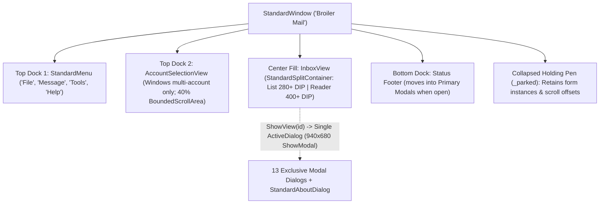

# Broiler Mail — Comprehensive Critical UI/UX Review & Impact Analysis

**Review Date:** 26 November 2026  
**Scope:** Full audit of all UI/UX specifications (`docs/*.md`, `docs/decisions/*.md`, `README.md`), shared presentation views and view models (`Broiler.Mail.Application`), platform heads (`Broiler.Mail.Windows`, `Broiler.Mail.Android`, `Broiler.Mail.Linux`), and ecosystem integration (`Broiler.UI`, `Broiler.UI.Extended`, `Broiler.UI.Shell`, `Broiler.Launcher` / `Broiler.Office`).  
**Companion Specifications:** [Refined UI/UX Concept Specification](ui-ux-concept.md) (authoritative target design) · [Detailed UI/UX Refinement Roadmap](ui-ux-roadmap.md) (`UX-M0`–`UX-M6` task breakdown).

---

## 1. Executive Summary & Historical Context

Broiler Mail possesses an unusually strong engineering and trustworthiness foundation. Its rendering pipeline is strictly JavaScript-free; its desktop binaries compile cleanly under NativeAOT; its submission state machine refuses to conflate SMTP server acceptance with recipient delivery or IMAP Sent-copy storage; its read-only default (`EXAMINE` / `BODY.PEEK`) never mutates server flags behind the user's back; and its October 2026 polish program (`UI-01` through `UI-13`) delivered live theming, Windows High Contrast support, UI Automation (UIA) semantics, scroll anchoring, and per-monitor DPI scaling.

However, Broiler Mail's UI/UX evolved in **two uncoordinated waves**:

1. **Wave 1 — Calm Reader Polish (30 Sep – 5 Oct 2026):** Documented in [experience-roadmap.md](experience-roadmap.md) and [ui-implementation-roadmap.md](ui-implementation-roadmap.md). Designed for a **single-account, INBOX-only, 4-tab shell** (`Inbox`, `Account`, `Settings`, `Compose`) with no local cache, no folders, no search, no attachments, and a separate-window HTML preview.
2. **Wave 2 — M0–M4 Functional Expansion (2 Nov – 26 Nov 2026):** Documented across [product-completion-roadmap.md](product-completion-roadmap.md) and 38 granular `m1-*` through `m4-*` slice records. Added up to 32 accounts, SQLite v5 durable offline mail, folder discovery and role mapping, verified `UID MOVE` / `UID EXPUNGE` / flag mutations with recovery journals, FTS5 search, compose and received attachments, 20-draft parking, recipient book, Outbox, `.eml` import/export/inspection, inline HTML, and an Android APK — while replacing the 4-tab bar with a `File`/`Message`/`Tools`/`Help` menu bar and **13 single-slot `940×680` modal dialogs**.

Because Wave 2 bolted 38 backend milestones directly onto Wave 1's single-folder layout without a unified spatial or interaction revision, **seven systemic UX problems** emerged:

1. **The "940×680 Modal-Over-Context" Anti-Pattern:** Contextual reader and list tools (`Find in message`, `Message actions`, `Search saved mail`, `Mailbox options`, `Compose`) open as `940×680` modal `StandardDialog`s covering the exact message or list the user is inspecting or acting upon.
2. **Missing Spatial Hierarchy Despite Multi-Account & Multi-Folder Delivery:** Although 32 accounts, 512 folders, pinned folders, `Unified saved inbox`, `Outbox`, and `Saved originals` now exist, there is still no collapsible folder/account navigation rail (`StandardTreeView`); folders sit in a flat toolbar `ComboBox`, and secondary views stuff up to 1,600 items into single-line `StandardComboBox` dropdowns.
3. **Invisible Received Attachments & 8-Step Extraction Ritual:** Neither message rows nor the reading pane indicate that an email has attachments; saving an attachment requires opening `⋯` → `Original message (.eml)` → re-downloading the entire `.eml` → inventorying parts → exporting to a hardcoded folder capped at 64 lifetime files.
4. **Zero File/Folder Pickers & Misuse of `StandardComboBox` as Data Tables:** Seven file/folder workflows require typing raw absolute OS paths (`C:\...`), which is hostile to beginners and structurally unusable under Android Storage Access Framework (SAF). Nine multi-record collections use `StandardComboBox` instead of `StandardListView` (with two live parameter-swap bugs displaying raw GUIDs in `SavedDraftsView` and hiding display names in `SavedRecipientsView`).
5. **Storage & Protocol Mechanics Leaking into Everyday UI:** Users must manually sequence four separate offline sync mechanisms, choose among 12 literal-vs-FTS5 search modes and 27 Cartesian filter strings, click `Refresh folders` before `Move`/`Archive`/`Trash` work in a session, and navigate multi-step password/save lockouts.
6. **Shortcut Collisions, Missing Tooltips & Broken Break-Out Input:** `Ctrl+F` means `Find in message` when focus is in the reader but `Forward` when focus is in the message list; primary actions (`New message`, `Reply`, `Reply all`, `Forward`) render as unlabeled Unicode glyphs (`✎`, `↶`, `⇇`, `↪`) without `StandardTooltipController` wired; and dialogs that break out into `WindowsHostWindow` lose `MailKeyboardNavigation` (`Enter` closes the dialog without saving; `Tab` inserts literal tabs).
7. **Severe Documentation Drift & Platform Divergence:** Twelve major factual contradictions exist across `README.md` and `docs/*.md`; `Broiler.Mail.Android` ships the unmodified desktop `28 DIP` menu bar and single-account Version 2 DI graph; and `Broiler.Office` hosts graphical Mail on Windows and Linux with capability gaps (`OfficeMailWindow` theme/tooltip hooks; `OfficeLinuxHostRunner` missing close-time draft flush).

---

## 2. Structured Inventory of the Existing UI/UX Design

### 2.1 Shell, Menus & Modal Architecture (`MailShellView.cs`)

| Surface ID | Presentation | Entry Path / Shortcut | Moves Footer? | Initial Focus Today | State on Close |
| --- | --- | --- | --- | --- | --- |
| `inbox` | Main workspace | `File → Inbox`, `Ctrl+1`, `Escape` | Owns footer | Restored `_readerFocus` or `Menu` | Persistent |
| `account` | `940×680` Modal | `Tools → Account...`, `Ctrl+2`, `Add account`, Startup (no profile) | Yes | Bottom `Close` button | Parked (dirty edits stay live!) |
| `settings` | `940×680` Modal | `Tools → Settings...`, `Ctrl+3` | Yes | Bottom `Close` button | Parked |
| `compose` | `940×680` Modal | `File → Open draft` (`Ctrl+4`), `New` (`Ctrl+N`), `Reply`/`Forward` | Yes | `To`/`Body` via command; **`Close` via `Ctrl+4`!** | Parked + autosaved |
| `outbox` | `940×680` Modal | `File → Other mail views → Outbox`, `Ctrl+5` | Yes | Bottom `Close` button | Parked |
| `originals` | `940×680` Modal | `File → Other mail views → Saved originals`, `Ctrl+6` | Yes | Bottom `Close` button | **Wiped (`SetActive(false)`)** |
| `unified` | `940×680` Modal | `File → Other mail views → Unified saved inbox`, `Ctrl+7` | Yes | Bottom `Close` button | **Wiped (`SetActive(false)`)** |
| `manage-accounts` | `940×680` Modal | `Manage accounts` button, `File → Accounts → Manage accounts…` | No | Bottom `Close` button | Cancels pending confirm |
| `account-activity` | `940×680` Modal | `File → Accounts → Account receives…` (no toolbar button!) | No | Bottom `Close` button | Parked |
| `removed-account-mail` | `940×680` Modal | `File → Accounts → Mail for removed accounts…` (no toolbar button!) | No | Bottom `Close` button | Cancels pending confirm |
| `mailbox-options` | `940×680` Modal | `Mailbox options` button, `File → Mailbox and message → Mailbox options…` | No | Bottom `Close` button | Parked |
| `search-mail` | `940×680` Modal | `⌕` toolbar button, `File → Mailbox and message → Search saved mail…` | No | `searchText` input | **Auto-closes on submit!** |
| `message-actions` | `940×680` Modal | `⋯` reader button, `File → Mailbox and message → Message actions…` | No | Bottom `Close` button | Resets parsed headers |
| `find-message` | `940×680` Modal | `Ctrl+F` (in reader), `Message actions → Find text`, `File → Mailbox...` | No | `_query` input | Collapses & clears find |
| `about` | `820×420` Modal | `Help → About Broiler Mail` | No | `StandardAboutDialog` default | Disposed |

### 2.2 Inventory of Views, Controls & Hard Limits

| Functional Area | Existing Controls & Interaction Pattern | Enforced Numeric / Operational Limits |
| --- | --- | --- |
| **Account Bar & Collection** (`AccountSelectionView`) | `Mail account` `ComboBox` (`280×32`), `Add account`, `Cancel new account`, `Manage accounts`. Sub-dialogs for enable/disable, reorder, removal (with `keep`/`forget` password choice), per-account cache clear, 2-slot FIFO `Account receives`, and `Mail for removed accounts`. | Max **32** accounts; **2** concurrent receive workers (**50** INBOX headers/account); **64** discoverable orphan account IDs; **3-stage** removal guard (blocks if drafts/uncertain intents/repair receipts exist). |
| **Account Setup & Identities** (`AccountProfileView`, `SenderIdentitiesView`) | Non-collapsible 4-line `Account setup` checklist + `Next` button; `Account identity` (name, email, signature); collapsible `Sender aliases` + per-address `Inherit`/`Override` customize form; collapsible `Composition defaults`; 2-tab `Incoming (IMAP)` / `Outgoing (SMTP)` with separate password save/forget/test controls, `Special-folder mapping` (5 role overrides), and `Sent-copy settings`. | Signature **≤4,000** chars; **≤16** aliases (**17** total identities; display name **≤200** chars); passwords **1–1,280** UTF-16 chars; **20 s** IMAP/SMTP test deadlines (+ **2 s** SMTP `QUIT`). |
| **Inbox & Folder Navigation** (`InboxView`) | Top toolbar: `✎` (`New message`), `Receive mail`, `Read message`, `Load older`, `×` (`Cancel`), `Mail folder` `ComboBox` (`240×32`), `Undo last move`, `⌕` (`Search saved mail`), `Mailbox options`. Split container (`280` min list / `400` min reader; compact `<680 DIP`). Two-line virtualized `StandardListView`. | **50** headers/page; **500** loaded headers/session; **512** max discovered folders (**1 MiB** `LIST` cap); **8** pinned folders & **8** offline folders per account; **4,096**-message complete folder snapshot cap. |
| **Message Reader & Inline HTML** (`InboxView`, `ScrollableHtmlView`, `RemoteImageActions`) | Header (`45%` max share, keeps 6 body lines): `Back to inbox` (compact), `Subject` (`Title` 24 DIP), `Sender and recipients` (read-only `StandardRichEdit`), `Received · Read/Unread · Starred · Offline` meta line, `↶` `⇇` `↪` `⋯` icon strip. Body: `ScrollableMessageText` (`MaxWidth = 720 DIP`) or tiled `ScrollableHtmlView` (with text selection & link context menu). Mode toggle, zoom (`50–300%`), `Top`/`End`, remote-image consent/reset, flags, move/trash/permanent-delete, parsed headers, and `.eml`/attachment tools all live inside `"message-actions"` modal! | Raw fetch **12 MiB** (`ImapMailReceiver.MaximumMessageBytes`); display text **32,000** chars; retained search text **1,048,576** chars; CID images **≤16** (**1 MiB** each, **2 MiB** total); remote images HTTPS:443 only, **≤16** images, **1 MiB**/image, **2 MiB** batch, **16 MP**; HTML height **32,768 CSS px**, cache **16 tiles / 256 MB**. |
| **Saved Search & FTS5 Index** (`InboxView`, `ProfileStorageView`) | `"search-mail"` modal: query (`256` chars), scope (`Current folder` / `All saved folders`), `Search filters` disclosure (`Sender`, **12-item** field/index mode combo, **27-item** read×star×body combo, **5-item** UTC date combo + custom `YYYY-MM-DD..YYYY-MM-DD`), `Find`, `Previous`/`Next`, `Clear`. Settings controls to inspect/rebuild/disable FTS5 index. | **50** results/page (**128** pages history); sorted by `UTF-8 BINARY` folder DESC, `UID` DESC; FTS5 `mail-cache.db.search.db` **256 MiB** cap. |
| **Composer, Drafts, Recipients & Outbox** (`ComposerView`, `SavedDraftsView`, `SavedRecipientsView`, `OutboxView`) | Start row (when `!HasDraft`), collapsible `Saved drafts` (park/resume/remove), `From` label + pre-draft `senderChoice`, `To`, collapsible `Cc and Bcc`, collapsible `Saved recipients`, `Subject`, collapsible `Attachments` (raw path box + combo), `Message` (`StandardRichEdit`), action bar (`Send`, `Cancel send`, `Check draft`, `Save draft`, `Discard draft`), 6-line severity-sorted feedback area. Separate `Outbox` (`Ctrl+5`) modal. | **1** active + **20** parked drafts; send limits: **1–100** recipients, **998** subject chars, **100,000** body chars (storage: **400k** body); attachments: **≤4** files, **8 MiB**/draft, **16 MiB** profile-wide (**32 MiB** `drafts.json`); **500** recipients/account (**2,000**/profile); **20 s** SMTP & IMAP `APPEND` deadlines. |
| **Originals & Received Attachments** (`SavedOriginalsView`, `LocalOriginalsView`, `MessageSourceExportActions`) | Per-message inside `"message-actions"` or account-wide in `Saved originals` (`Ctrl+6`): export/verify server `.eml`, inspect 64 KiB escaped ASCII prefix, inventory & extract attachments; open/decode/HTML-preview/import/export/remove standalone local `.eml` files via raw path fields. | Server `.eml` & attachment exports: **12 MiB**/file, **64 files / 128 MiB** each (no UI cleanup!); local `.eml` open/import: **2 MiB**/file, **16 files / 4 MiB** (`8 MiB` JSON); inline source preview: **64 KiB**. |
| **Settings & Storage** (`SettingsView`, `ProfileStorageView`) | `Theme`, `Inbox row spacing`, `Initial window width/height`, collapsible `Keyboard shortcuts`, collapsible `Local mail storage` (download policy, SQLite quota `1–16384 MiB`, manual cache repair, `Uncertain server actions` review/dismissal, FTS5 index maintenance, verified backup, whole-cache clear, separate-profile restore + launch). | Default SQLite quota **256 MiB** (Windows smoke `64 MiB`, view model default `512 MiB` fallback); max **128** recovery receipts; zero automatic eviction. |

---

## 3. Explicitly Preserved Solutions & Design Decisions

Following the core review mandate — *never replace proven solutions merely because alternatives exist* — the following architectural and UX decisions are **explicitly preserved** in the refined concept:

1. **JavaScript-Free Security Invariant & Passive HTML Pipeline:** `HtmlPreviewPolicy` sanitization, `default-src 'none'`, blocked automatic remote resources, DNS-pinned HTTPS:443 `RemoteImageBroker` with per-message consent and reset (`Block remote images again`), deliberate external HTTP(S) link opening, and explicit uncontained-renderer disclosure until OS child-process isolation (`A2`) passes.
2. **Three-Way Separation of Draft Storage, SMTP Submission & Sent-Copy Outcomes:** `Accepted`, `Failed`, and `Unknown` SMTP states remain distinct from `Saved`, `Failed`, and `Unknown` IMAP Sent-copy states. `Unknown` submission outcomes **never** auto-retry or enable one-click blind resending; failed Sent copies **never** re-enable SMTP sending.
3. **Read-Only Default Receiving (`EXAMINE` / `BODY.PEEK`):** Selecting or reading a message never mutates server `\Seen` flags by default ([Decision 0003](decisions/0003-read-only-receiving.md)). *(Refinement adds an explicit opt-in user setting for users who want automatic mark-read after viewing, while keeping read-only as the default.)*
4. **Server-Bound OS Credential Slots & Non-Sending Connection Tests:** Separate `Imap` and `Smtp` OS vault slots bound to `(host, port, username, TLS, auth)` fingerprints ([Decision 0002](decisions/0002-credentials-and-imap-test.md)), mandatory TLS/STARTTLS without plaintext fallback, and non-sending `AUTH`+`QUIT` SMTP testing ([Decision 0006](decisions/0006-non-sending-smtp-test.md)).
5. **Verified Mutations, Keep-First Confirmations & Recovery Receipts:** Single-message `UID MOVE` (`COPYUID` + source/destination verification + 1-level session reverse-MOVE Undo), Trash-only `UID EXPUNGE` permanent deletion, pre-network mutation intents (`mail-cache.db.intents.json`), startup/manual local receipt repair, and focusing the safe `Keep` button first on destructive prompts.
6. **Refresh Continuity (`UI-02`) & Adaptive Two-Line Row Presentation (`UI-04`):** Reconciling refreshes by `(AccountId, MailboxId, UIDVALIDITY, UID)`, preserving scroll anchor (`EnableScrollAnchoring`) and open message selection/scroll/text-selection, and stepping down sender/date formatting cleanly before truncating subjects while keeping full details in UIA accessible names.
7. **Calm Reader Typography, Live Theme Precedence & Accessibility Foundations (`UI-01`, `UI-07`, `UI-09`, `UI-10`):** Native OS title bar with dark-mode sync, `AppearancePolicy` (`High Contrast > Explicit Light/Dark > System`, plus live OS `TextScale` and `ReducedMotion`), `ReadingColumn` (`720 DIP` prose width), `BoundedScrollArea` whole-line snapping, exact shortcut modifier matching (`AltGr`-safe), IME suppression on password/non-editable controls, `UseMnemonic = false` on dynamic text, and transient 6-second auto-clearing confirmations vs. persistent errors.
8. **Zero Automatic Cache Eviction:** Keeping downloaded mail until explicitly cleared by the user (rather than silently purging offline messages LRU-style when offline on an airplane or train) remains a strong product differentiator for an "Email & offline archive" client.

---

## 4. Catalog of Weaknesses, Contradictions, Live Defects & UX Gaps

Findings are ranked by user impact:
- **Critical (P0):** Live bugs, broken core workflows, obscured context, or accessibility/input failures.
- **Major (P1):** Severe friction in daily workflows, leaked internal mechanics, cross-platform gaps, or major doc drift.
- **Moderate (P2):** Power-user efficiency gaps, secondary view ergonomics, microcopy clutter, and polish.

### 4.1 Critical Findings (P0)

| ID | Area | Finding & Verified Source Evidence | User Impact |
| --- | --- | --- | --- |
| **UXR-01** | Reader & Search Modality | **940×680 Modal-Over-Context Anti-Pattern (`MailShellView.cs:182-256`, `InboxView.cs:171-181, 229-238, 459-481`):** `Find in message`, `Message actions`, `Search saved mail`, and `Mailbox options` are detached from `InboxView` and opened as `940×680` modal `StandardDialog`s. Opening `Find in message` (`Ctrl+F`) covers the message text so `Next match` highlights matches invisibly underneath the modal. Opening `Message actions` (`⋯`) hides the email while clicking `Zoom in`, `HTML / Plain text`, `Load remote images`, `Archive`, or `Move to trash` (leaving the modal stranded over a deselected message after move/trash). | Breaks visual feedback and spatial context for reading, finding text, zooming, approving remote images, and triaging mail across all user levels. |
| **UXR-02** | Live UI Bug (Drafts & Recipients) | **Reversed `UiComboBoxItem(Id, Text)` Arguments (`SavedDraftsView.cs:60`, `SavedRecipientsView.cs:67`):** `UiComboBoxItem` expects `(string Id, string Text)`. `SavedDraftsView` passes `(Title(row), row.Draft.Id.ToString())`, displaying raw GUIDs (`0b7c2f4e-...`) instead of draft subjects/states! `SavedRecipientsView` passes `(row.Label, row.Address)`, hiding saved recipient display names (`Alice <alice@example.com>`). | Users cannot identify which saved draft they are resuming or deleting, and saved recipient names are invisible in the picker. |
| **UXR-03** | Broken-Out Window Input | **Broken Keyboard Handling in `WindowsHostWindow` (`WindowsHostWindow.cs:97, 257-264`, `MailShellView.cs:234`):** Every `StandardDialog` uses `BreakOutMode = Automatic` at `940×680`. Whenever the main window is smaller than `~964×704 DIP` (including `640×480` compact mode!) or dragged out, `WindowsHostWindow` hosts the dialog **without `MailKeyboardNavigation`**: pressing `Enter` in any `StandardEdit` bubbles to `StandardDialog.Accept()` and **closes the dialog without saving**; pressing `Tab` in `ComposerView`'s body inserts literal `\t` tabs instead of moving focus; global shortcuts fail. | Severe data/workflow disruption for keyboard users and small-screen/compact-window users. |
| **UXR-04** | Shortcut Collision | **`Ctrl+F` Dual-Meaning Collision (`MailShortcuts.cs:57` vs `InboxView.cs:527-528`, `MessageTextFindBar.cs:114`):** `Ctrl+F` triggers **Forward** when focus is in the message list (and is listed as `Forward` in `Message` menu and `SettingsView`), but triggers **Find in message** when focus is anywhere in the reading pane! | Unpredictable mode error: pressing `Ctrl+F` to find text before clicking inside the reader opens a Forward draft; pressing `Ctrl+F` to forward while reading opens Find. |
| **UXR-05** | Disappearing Search Context | **Invisible Active Search State (`InboxView.cs:255-262`):** Submitting a search in `"search-mail"` closes the modal and populates the Inbox list, leaving **no visible search bar, no `Clear search` button, and no `Previous`/`Next` page buttons** on screen while disabling `Receive mail` and `Load older`. | Beginners get stuck in filtered search results with `Receive mail` disabled; paging results requires reopening the modal every page. |
| **UXR-06** | Unlabeled Icons & Missing Tooltips | **Unlabeled Glyph Buttons Without Tooltip Controller (`InboxView.cs:99, 108, 154, 368-370, 429`, `StandardButton.cs:321-328`, `WindowsMailWindow.cs:100-167`):** Setting `IconPainter` suppresses `StandardButton.Text` visually, leaving `✎`, `×`, `⌕`, `↶`, `⇇`, `↪`, `⋯` as unlabeled `34×34` Unicode characters (violating `ui-implementation-roadmap.md:87`), AND neither `WindowsMailWindow` nor `OfficeMailWindow` attaches `StandardTooltipController`, so **`ToolTipText` never renders on hover**! | Sighted pointer users see cryptic Unicode symbols (`↶`, `⇇`, `↪`) with zero text labels and zero hover tooltips. |
| **UXR-07** | Attachments UX | **Invisible Attachments & 8-Step Extraction Ritual (`MailMessageSummary.cs`, `MailMessageBody.cs`, `InboxView.cs:445-472`, `MessageAttachmentActions.cs`):** Neither list rows nor the reader header/body indicate attachment presence, nor is remote-image blocking shown in the reader. Saving an attachment requires `⋯` → `Original message (.eml)` → `Download original .eml` → `Read attachments` → select in `ComboBox` → `Save` to hardcoded `attachment-exports/` (capped at **64 files total** with no cleanup UI or Save-As dialog). | Everyday users assume attachments failed to arrive or are unsupported; heavy users hit a permanent 64-file quota wall. |
| **UXR-08** | File & Folder Selection | **Raw Absolute Filesystem Path Text Boxes (`ComposerView.cs:118`, `LocalOriginalsView.cs:73, 77`, `ProfileStorageView.cs:71, 82-83`):** Seven workflows require manually typing/pasting OS paths (`C:\Users\...`) instead of using `Broiler.UI.Shell`'s `StandardFileDialog` or OS/SAF pickers. | Unusable on Android (SAF content URIs required); error-prone and intimidating on desktop. |

### 4.2 Major Findings (P1)

| ID | Area | Finding & Verified Source Evidence | User Impact |
| --- | --- | --- | --- |
| **UXR-09** | Composer Modality | **Modal Composer Blocks Reading Reference Mail (`MailShellView.cs:230-290`):** Compose opens via `ShowModal`, preventing users from scrolling the Inbox, opening a second email to check a date/figure, or viewing `Saved originals` without closing and reopening Compose. | High friction during everyday email writing and multi-message synthesis. |
| **UXR-10** | Spatial Navigation | **No Folder/Account Navigation Rail (`InboxView.cs:111-149`, `AccountSelectionView.cs:41-46`):** Up to 512 server folders are flattened into a `240×32` toolbar `ComboBox` with concatenated status suffixes; `Pinned folders` require 4 clicks inside `Mailbox options` + clicking `Open pinned folder`; `Account receives` and `Removed-account mail` have no button in `AccountSelectionView` when `Shell != null`. | Poor spatial orientation and slow folder/account switching once more than 1 account or 3 folders exist. |
| **UXR-11** | Data Presentation | **`StandardComboBox` Used as Multi-Row Data View in 9 Places (`UnifiedSavedInboxView.cs:43`, `OutboxView.cs:41`, `SavedOriginalsView.cs`, `LocalOriginalsView.cs:55`, etc.):** Up to **1,600** unified inbox messages, 21 outbox records, 64 saved originals, 16 local imports, 4 draft attachments, 32 received attachments, and 64 orphan accounts are stuffed into single-line `ComboBox` dropdowns instead of virtualized `StandardListView`s. | Impossible to scan, compare, or keyboard-browse message collections comfortably. |
| **UXR-12** | Search Complexity & Ordering | **12 Engine Modes, 27 Combined Filter Strings & Binary Folder Sort (`InboxView.cs:188-198`, `m4-search.md:13-15`):** Search exposes internal storage distinctions (`Saved body preview` vs `Indexed headers/body preview` vs `Indexed complete retained body`), multiplies 9 flag states × 3 cache states into 27 dropdown items, sorts cross-folder results by `UTF-8 BINARY folder DESC, UID DESC` instead of `ReceivedAt DESC`, and aborts pagination if any folder head changes. | Confuses beginners and advanced users alike; cross-folder results appear grouped by Z→A ASCII folder name rather than newest mail first. |
| **UXR-13** | Offline Choreography | **Four Uncoordinated Manual Offline Workflows (`InboxView.cs:110-135`):** Separate buttons for (1) `Download loaded messages`, (2) `Receive selected-folder headers` + `Show saved headers`, (3) `Download selected offline folders` + `Restart offline batches`, and (4) `Snapshot all headers` (`SHA-256` census). Acquiring headers in (2) neither updates the visible list nor resets (3)'s cursor automatically. | Even technical users struggle to keep selected folders available offline without missing messages. |
| **UXR-14** | Account & Password Flow | **Password-Wiping Save Trap & Parked Unsaved-Edit Lockout (`AccountProfileView.cs:267, 498`, `AccountSelectionViewModel.cs:44-45`):** Clicking `Save account` clears typed password fields to `""` without saving them, while `Save password` refuses to run before `Save account`. Closing `Account` with unsaved edits parks dirty state in `_parked`, silently disabling the main window's account switcher, `Add account`, `Manage accounts`, and `Account receives`! | Frustrating re-typing during setup; mysterious global UI lockouts after closing Account dialog with an accidental edit. |
| **UXR-15** | Draft Lifecycle & Discard Safety | **Blocked New/Reply When Draft Exists, Locked `From`, & Unconfirmed `Discard` (`ComposerView.cs:137, 172-176, 300`):** Clicking `New`/`Reply`/`Forward` while an unsent draft exists fails instead of auto-parking into the 20-draft library; `From` alias cannot be changed once a draft starts; and `Discard draft` permanently deletes user text in **one click with zero confirmation** (unlike every other delete action!). | Accidental loss of long drafts on misclick; unnecessary friction when switching between two compositions or correcting a reply alias. |
| **UXR-16** | Hidden Session Prerequisites | **Manual Folder Discovery Gate & Blank-on-Open Views (`InboxViewModel.cs:85, 98`, `UnifiedSavedInboxView.cs:68`, `SavedOriginalsView.cs`):** Selecting a folder never fetches from IMAP; `Move destination` is empty and `Archive` / `Move to trash` / `Delete permanently…` are disabled/hidden until the user manually clicks `Mailbox options → Refresh folders` in that session! `Unified saved inbox` and `Saved originals` open empty and wipe all loaded rows on close. | Features appear broken (`Move destination` empty, `Trash` button missing) until the user discovers hidden manual refresh steps. |
| **UXR-17** | Size & Reader Truncation Traps | **Asymmetric Limits (`LocalOriginalsView.cs:244`, `InboxView.cs:764`):** `ImapMailReceiver` and `.eml` export support **12 MiB**, Compose sends **8 MiB** attachments (~11 MiB MIME), yet `LocalOriginalsView` rejects `.eml` files over **2 MiB** (cannot open `.eml` files exported by Broiler Mail itself!). Meanwhile SQLite retains **1,048,576** body chars for search, but the reader hard-truncates at **32,000** chars with no `"Show full text"` button, and `.eml` opening defaults to raw `\xNN` ASCII bytes instead of decoded content. | Dead-ends when inspecting exported `.eml` mail or reading search hits located past 32,000 characters. |
| **UXR-18** | Android & Linux Host Gaps | **Desktop UI & V2-Only DI on Android; Unprotected Close on Linux Office (`Android/CompositionRoot.cs:9-18`, `MainActivity.cs:46, 108-114`, `OfficeLinuxHostRunner.cs:254-260`):** Android wires single-account `JsonAccountStore` (no SQLite cache, multi-account, folders, search, or attachments), renders `28–34 DIP` desktop controls (< `48×48 dp`), shows desktop `Initial window width/height` and `Ctrl+1..7` settings, forces dark status-bar icons in Dark Mode, and throws on `About` website tap. `OfficeMailWindow` lacks `IUiSystemSettingsHost`/tooltips/restore; `OfficeLinuxHostRunner` skips `PrepareCloseAsync()` on close. | Android users get a tiny desktop UI missing M1–M4 features; Linux Office users can lose unsaved draft edits on window close. |
| **UXR-19** | Dialog Initial Focus | **Initial Focus Lands on Bottom `Close` Button (`MailShellView.cs:301`):** Opening `Account`, `Settings`, `Outbox`, `Saved originals`, `Unified saved inbox`, `Manage accounts`, `Mailbox options`, `Message actions`, or `Compose` (via `Ctrl+4`) places keyboard focus on `Close` at the bottom instead of the first interactive control. | Screen-reader and keyboard users must `Tab` wrap past `Close` and the menu bar on every dialog open. |

### 4.3 Moderate Findings (P2)

| ID | Area | Finding & Verified Source Evidence | User Impact |
| --- | --- | --- | --- |
| **UXR-20** | Power-User Triage | **No Multi-Select, Context Menus, or Triage Shortcuts (`InboxView.cs:268`, `MailShortcuts.cs`):** `StandardListView` supports `Multiple` selection (`Ctrl`/`Shift`), and `StandardMenu` supports `ContextMenu`, yet Mail supports only single-row selection, has zero right-click menus on rows/folders, and lacks `Delete` (Trash), `Shift+Delete`, `Archive`, `Mark read/unread`, `Star`, `Ctrl+Enter` (Send), and `Ctrl+S` (Save draft). | Triage of 20+ daily emails requires repetitive mouse travel per message. |
| **UXR-21** | Recipient Entry | **Manual 5-Step Recipient Lookup & Stripped Display Names (`SavedRecipientsView.cs:34-98`, `ComposerViewModel.Recipients.cs:37`):** No inline autocomplete while typing in `To`/`Cc`/`Bcc`; inserting from `Saved recipients` inserts only `recipient.Address` (discarding `recipient.Name`), and there is no 1-click "Save sender to recipient book" in the reader. | Extra steps for frequent correspondents; outgoing headers lose saved display names. |
| **UXR-22** | Backup & Quota Catch-22s | **Mandatory Full Backups Before Every Cleanup & Orphan GUIDs (`ProfileStorageView.cs`, `AccountSelectionView.cs:156-157`, `m4-local-originals.md:17`):** Clearing cache or even deleting a single `.eml` import copies the entire SQLite DB into a new un-rotated backup folder (blocking cleanup when disk is full!), and `Mail for removed accounts` displays raw `AccountId` GUIDs without email labels. | Disk-full recovery deadlock; inability to identify which removed account's mail is being deleted; silent exclusion of `source-exports/` and `attachment-exports/` from backups. |
| **UXR-23** | Reading & Window Polish | **Missing Settings & Chrome Polish (`SettingsView.cs`, `WindowsMailWindow.cs:76`, `MailShellViewModel.cs:57`):** `PreferPlainText` has no control in `SettingsView`; reading has no opt-in "Mark read when opened"; `MailWindowIcon.TryAttach` is commented out on Windows; window title is static `"Broiler Mail"` (no active account/folder context); `MailShortcuts.All` lists `Ctrl+7, 6, 5` out of order; `File → Receive mail` ignores `CanReceive`; `DemoApplication.cs:326` still says `"Select Open HTML preview"`. | Discoverability and polish gaps across everyday desktop use. |
| **UXR-24** | Microcopy Overload | **Defensive Engineering Disclaimers in Primary Views (`LocalOriginalsView.cs:72`, `UnifiedSavedInboxView.cs:54`, `ProfileStorageView.cs:64`, `OutboxView.cs:45`):** 4–6 sentence paragraphs detailing `SHA-256`, `UIDVALIDITY`, `CAS`, `FTS5`, and backup caveats appear above primary controls. | High cognitive load for beginners; pushes interactive controls below the fold at `640×480` or `200%` text scale. |

---

## 5. Complete Inter-Document Contradiction Matrix

| # | Topic | Stale / Conflicting Claim (File & Lines) | Actual Baseline / Newer Spec | Authoritative Resolution in Refined Concept |
| --- | --- | --- | --- | --- |
| 1 | **Shell Navigation** | 4-tab bar (`Inbox`, `Account`, `Settings`, `Compose`) with `Ctrl+Tab`: `architecture.md:43,244,337`, `ui-implementation-roadmap.md:518,680`, `ui-manual-acceptance-checklist.md:123,383`, `README.md:375,433`. | Menu bar + modal views (`README.md:132-147`, `MailShellView.cs:367-398`). | Adopt standard Broiler menu bar (`File`, `Edit`, `View`, `Message`, `Tools`, `Help`) + progressive 3-pane/2-pane/1-pane workspace + right-sized dialogs. |
| 2 | **Top-Level Menu Name** | Named **`Mail`** menu in `README.md:132,242,244` and `product-completion-roadmap.md:432,470`. | Named **`File`** in `MailShellView.cs:374` (`AccessibleName = "Mail menu"`). | Standardize on **`File`** (`Edit`, `View`, `Message`, `Tools`, `Help`) matching `Writer`, `Cells`, `Plate`, and `Launcher`. |
| 3 | **`Ctrl+F` Binding** | Bound to **Forward** in `README.md:146`, `MailShortcuts.cs:57`, `ui-implementation-roadmap.md:1263`. | Bound to **Find text** inside reader (`m2-message-find.md:8`, `InboxView.cs:528`). | Bind **`Ctrl+F`** exclusively to **Find in message**, **`Ctrl+K` / `Ctrl+E`** to **Search mail**, and **`Ctrl+L` / `Ctrl+Shift+F`** to **Forward**. |
| 4 | **Attachment Support** | `"Attachments... cannot be opened or saved"` (`README.md:324`, `architecture.md:233`); reminder says `"attachments are not supported"` (`product-completion-roadmap.md:408`, `m4-three-everyday-items.md:18`). | 4-file / `8 MiB` compose & `12 MiB` received attachments shipped (`m4-compose-attachments.md:3`, `ComposerViewModel.cs:166`). | Update all docs to reflect shipped attachment support + refine UI to inline reader attachment strip & `StandardFileDialog`. |
| 5 | **Message & `.eml` Byte Cap** | **2 MiB** cap claimed in `README.md:244,317`, `m4-received-attachments.md:13` (contradicting line 3 of the same file!), `m4-saved-originals.md:5`, `m4-original-library.md:11`, `LocalOriginalsView.cs:244`. | **12 MiB** streamed cap in `ImapMailReceiver.cs:47` and `m4-original-source-export.md:5`. | Unify inbox reading, `.eml` export, and `.eml` open/decode ceiling at **12 MiB**; document profile-backed import quota separately. |
| 6 | **`drafts.json` Limit** | **4 MiB** file cap in `README.md:246`, `architecture.md:343`, `m1-persistence.md:271`, `m4-multiple-drafts.md:7`, `m4-visible-outbox.md:5`. | **32 MiB** store cap (**8 MiB**/draft, **16 MiB** shared attachments) in `m4-compose-attachments.md:3`. | Record **32 MiB** store cap (`8 MiB`/draft, `16 MiB` profile attachment quota) consistently across all docs. |
| 7 | **HTML Host & Selection** | Separate `HtmlPreviewWindow` / `IHtmlPreviewHost` (`architecture.md:54,433`, `version-2-acceptance.md:19`); `"Direct selection in the HTML canvas... remain follow-ups"` (`m0-m4-completion-status.md:7,26`). | Inline `IInlineHtmlPreviewHost` (`m2-inline-reader.md:5`); `ScrollableHtmlView.cs:1319-1373` **already implements** text selection, I-beam cursor, `Ctrl+A`/`C`, and link context menu! | Document inline `IInlineHtmlPreviewHost` + shipped HTML text selection & context menu accurately; keep OS process sandbox (`A2`) clearly marked open. |
| 8 | **Remote-Image Broker** | `.NET HttpClient`, HTTP/HTTPS allowed, **5 MB** per image (`decisions/0005:71`, `architecture.md:439`). | `Broiler.Net` DNS-pinned **HTTPS:443 only**, **1 MiB**/image, **2 MiB** batch (`m2-remote-image-broker.md:28-56`). | Record `Broiler.Net` HTTPS:443 / `1 MiB` / `2 MiB` policy as authoritative. |
| 9 | **Accounts, Drafts & SQLite** | Single account (`accounts.json`), 1 draft, in-memory inbox, SQLite v2/v3, session-only offline cursors (`README.md:28,408-415`, `architecture.md:178`, `decisions/0010:24`). | 32 accounts (`account-collection.json`), 1+20 drafts, SQLite **v5**, durable body cursors (`m1-durable-offline-progress.md:5`, `m1-mailbox-header-snapshots.md:17`). | Record SQLite v5, 32 accounts, 21 drafts, and durable body cursors vs session header cursors accurately. |
| 10 | **Protocol Library** | Claims `MailKit 4.18.1` and `MimeKit` (`architecture.md:20,204,235`, `decisions/0002`–`0006`, `cross-platform-roadmap.md:11`). | Neither package is referenced in `Directory.Packages.props` or `Broiler.Mail.Infrastructure.csproj` (custom managed IMAP/SMTP/MIME stack). | Document the zero-MailKit managed protocol/MIME implementation in `Broiler.Mail.Infrastructure`. |
| 11 | **Android & Linux Hosts** | `"No Android Mail head exists"` (`cross-platform-roadmap.md:112`, `hosting-packages.md:22`); `"No Linux GUI host exists"` (`linux-host.md`). | `Broiler.Mail.Android` APK/AAB exists (`android.md`); `Broiler.Office` (`OfficeLinuxHostRunner.cs:167`) runs graphical Linux Mail (`0600` AES-GCM credentials)! | Reconcile standalone vs `Broiler.Office` host status for Windows, Android, and Linux. |
| 12 | **Live Provider Testing** | `"No public provider is advertised as validated"` (`README.md:195`, `version-2-smtp-checklist.md:5`). | Live IONOS IMAP TLS/993 + SMTP STARTTLS/587 NativeAOT probe passed (`m4-provider-acceptance.md:3-20`). | State accurately: controlled fixtures + scoped IONOS validation completed; broad multi-provider matrix remains M5 work. |

---

## 6. Cross-Component & Ecosystem Impact Evaluation

Every proposed refinement was evaluated against all layers of Broiler Mail and sibling Broiler components to verify architectural fit and prevent regressions:

| Proposed Refinement | `Mail.Core` Impact | `Mail.Application` Impact | `Mail.Infrastructure` Impact | `Broiler.UI` / `Shell` / `Hosting` Impact | Risk & Mitigation |
| --- | --- | --- | --- | --- | --- |
| **1. Progressive 3-Pane / 2-Pane / 1-Pane Layout with Collapsible Folder/Account Rail** | None (`MailFolder`, `AccountProfile`, `MailFolderRoles` already exist). | Compose outer `StandardSplitContainer` + `StandardTreeView` (`ADR 0023`); switch `Unified`, `Outbox`, `Originals` inline in workspace. | Persist rail width & collapsed state in `ApplicationSettings`; cache last discovered `MailFolder` list in SQLite so folders appear offline at startup. | Uses stock `StandardSplitContainer` and `StandardTreeView` (`0.1.0-preview.36`). Note: `StandardTreeView` ignores `IconKey` today — use text/role labels & `SecondaryLabel` counts, no custom tree fork needed. | **Risk:** Narrow windows squeezed by 3 panes. **Mitigation:** Rail auto-collapses below `980 DIP`, preserving exact `680 DIP` 2-pane → 1-pane `AdaptiveInboxLayout` behavior. |
| **2. De-Modalize Contextual Tools (Inline Find, Persistent Search Bar, Inline Reader Banners, Popup `⋯` Menu)** | None. | Keep `MessageTextFindBar`, `RemoteImageActions`, attachment strip, and active search bar inline in `InboxView`; use `StandardMenu` (`Overflow`/`ContextMenu`) for `⋯`. | None. | Uses stock `StandardMenu` popup (`OpenPopup()`), `StandardToolbar`, and `InlineFeedback`. | **Risk:** Vertical reader crowding at `640×480` / `200%` text. **Mitigation:** Keep banners compact (1 line) inside `BoundedScrollArea` (`45%` cap, 6 body lines guaranteed). |
| **3. Modeless / Break-Out Composer + `WindowsHostWindow` Input Parity + Auto-Park Drafts** | None (`ParkDraftAsync` already exists). | Open Compose via `ShowModeless` on desktop (modal/full-pane on Android); keep `From` editable while `SubmissionState == Editing`; add Keep-first prompt to `Discard draft`. | None (`DraftJournal` & `drafts.json` CAS unchanged). | Route `MailKeyboardNavigation` (or dialog Enter/Tab filter) in `WindowsHostWindow` and `OfficeHostWindow`. | **Risk:** Switching accounts in main window while Compose is open. **Mitigation:** Existing `ComposerViewModel` already pins `DraftAccountId` independently of `InboxViewModel`'s active account! |
| **4. Direct 1-Click Attachment Strip & `StandardFileDialog` / SAF Integration** | Add lightweight `MailAttachmentInfo` list to `MailMessageBody`, `HasAttachments` bool to `MailMessageSummary`, and `IMailFilePicker` stream port. | Render attachment indicator in `MailMessageItemPresenter` and attachment strip in reader; replace 7 raw path `StandardEdit`s with `Browse…` / `Save As…` actions. | Populate attachment metadata during existing MIME decode; stream direct save to user-chosen `Stream` / path (retiring 64-file `attachment-exports/` cap for Save As). | Uses stock `Broiler.UI.Shell` `StandardFileDialog` (`Open`/`Save`) on desktop, small `StandardDialog`+`StandardListView` folder picker (`PlateFolderDialog` pattern), and Android SAF `Intent`s; aligns directly with M7 cloud file-dialog roadmap (`IUiFileDialogDirectoryProvider`). | **Risk:** Oversized/untrusted filenames. **Mitigation:** Retain strict RFC 2231 sanitization and stream byte caps (`12 MiB` receive, `8 MiB` compose). |
| **5. Simplified Search UI, `ReceivedAt` Ordering & Full Retained-Body Expand** | Add `ReceivedAtDescending` sort default to `IMailLocalSearch`; expose `ReadRetainedBodyAsync` on `IMailCache`. | Replace 12-item & 27-item combos with 3 human scopes + 3 orthogonal filter combos; add `"Show full message text"` when truncated at 32k chars. | Order SQLite/FTS5 query by `(received_utc DESC, mailbox ASC, uid DESC)` with keyset cursor. | Uses stock `StandardComboBox`, `StandardEdit`, `StandardToolbar`. | **Risk:** Large retained text slow in `StandardRichEdit`. **Mitigation:** `RichEditLayout` already uses `O(log N)` binary search visible-line rendering (`C-03`), bounded to `1,048,576` chars. |
| **6. Non-Colliding Shortcuts, Labeled Primary Actions, Vector Icons & Working Tooltips** | Add `EnableSingleKeyShortcuts` to `ApplicationSettings`. | Rebind Forward to `Ctrl+L`/`Ctrl+Shift+F`, Search to `Ctrl+K`/`Ctrl+E`, Find to `Ctrl+F`; add modifier-safe list triage chords (`Delete`, `Shift+Delete`, `Ctrl+Q`, `Ctrl+Shift+A`, `Ctrl+Shift+G`) + opt-in single-key mode & context menus; keep text labels on primary buttons; draw `16×16` vector icons for secondary icon buttons. | None. | Attach `StandardTooltipController` in `WindowsMailWindow`, `WindowsHostWindow`, and `OfficeMailWindow` (zero idle CPU via `IsWaiting`). | **Risk:** Single-key shortcuts colliding with `StandardListView.TypeAhead` or firing while typing. **Mitigation:** Default to modifier chords; opt-in single-key (`E`, `S`, `U`) executes **only** when `FocusedElement` is `StandardListView` or read-only viewer. |
| **7. Unified Account Save+Password Flow & Android / Linux / Office Host Parity** | Add `PreferPlainText` & `MarkReadOnOpen` to `ApplicationSettings`. | Save non-secret profile + typed password sequentially in one `Save account` action; prompt on closing dirty `Account` dialog; replace `ComboBox` tables with `StandardListView`. | Wire existing `SqliteMailCache` & M3/M4 JSON stores into `Broiler.Mail.Android/CompositionRoot.cs`. | Enable `48×48 dp` compact sizing & dark-bar fix on Android; add `PrepareCloseAsync()` to `OfficeLinuxHostRunner`; wire `IUiSystemSettingsHost` in `OfficeMailWindow`. | **Risk:** Partial failure when saving profile + password together. **Mitigation:** Commit profile first, then vault secret; if vault fails, profile remains saved and inline error focuses password retry without wiping server fields. |

---

## 7. Explicitly Rejected Changes (Avoiding Bloat & Overengineering)

To protect Broiler Mail's simplicity, performance, and architectural focus, the following ideas were **evaluated and rejected**:

1. **Rejected — Custom Tokenized "Recipient Chip" Control Now:** `Broiler.UI` has no chip/pill control yet. Building a custom multi-selection chip editor with clipboard serialization, comma-quoted display names, IME, and UIA screen-reader support is high-risk toolkit engineering with marginal gain over `StandardEdit` + lightweight dropdown prefix autocomplete + field-level validation (`FormField.SetError`). Defer chips until `Broiler.UI` introduces a shared `TokenEdit` across multiple apps.
2. **Rejected — Rich HTML Outgoing Composer in Core Polish:** Coupling outgoing HTML composition to received HTML reading adds paste-sanitization, multipart/alternative drift, and font-styling complexity unrelated to fixing current workflows. Keep plain-text composition clean and fast now; evaluate rich composition separately in M7.
3. **Rejected — Automatic LRU Cache Eviction:** Automatically deleting cached bodies under quota pressure undermines Broiler Mail's core value proposition as a deterministic offline archive. Keep explicit quotas + clear per-account/folder cleanup + emergency no-backup disk-full clear.
4. **Rejected — Collapsing Send States into "Optimistic Sent" or Blind Background Resend:** Hiding `Unknown` SMTP outcomes or auto-retrying uncertain sends risks duplicate emails to real recipients. Keep honest `Sending` / `Accepted` / `Failed` / `Unknown` states and visible `Outbox` inspection.
5. **Rejected — Custom Owner-Drawn Window Frame, Blur/Translucency, or Decorative Animations:** Native OS captions (`DWMWA_USE_IMMERSIVE_DARK_MODE`) give zero-cost OS window snapping, contrast compliance, and zero idle GPU load.
6. **Rejected — Remote Contact Avatars (Gravatar / BIMI / Favicon Fetching):** Automatically querying third-party servers for sender avatars leaks recipient reading activity and violates Broiler Mail's strict no-automatic-remote-request privacy posture. Local deterministic sender initials (optional, density-dependent) require zero network access.
