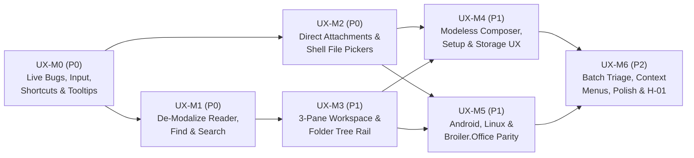

# Broiler Mail — Detailed UI/UX Refinement Roadmap

**Created:** 26 November 2026  
**Status:** Actionable implementation plan (`UX-M0` through `UX-M6` / packages `UX-01` through `UX-10`).  
**Companion Specifications:**
- [Refined UI/UX Concept & Interaction Specification](ui-ux-concept.md) — Target layouts, controls, menus, shortcuts, states, and platform adaptations.
- [Comprehensive Critical UI/UX Review (26 November 2026)](ui-ux-review-2026-11-26.md) — Evidence, source citations, `UXR-01`–`UXR-24` findings, and inter-document contradiction matrix.
- [Product Completion Roadmap](product-completion-roadmap.md) — Underlying M5–M7 protocol/sync/OAuth/release tracks and `A2` renderer process isolation gate.

---

## 1. Roadmap Structure, Sequencing & Priorities

This roadmap translates all **24 review findings (`UXR-01`–`UXR-24`)** and **12 documentation contradictions** into **7 sequenced milestones (`UX-M0`–`UX-M6`)** comprising **31 concrete, testable engineering tasks**.

- **P0 (Immediate Stabilization & Core Usability):** Fixes live UI bugs, broken keyboard handling in break-out windows, shortcut collisions, missing tooltips, `940×680` modals obscuring reading/searching, invisible attachments, and raw file-path text inputs.
- **P1 (Spatial Architecture, Workflow Ergonomics & Platform Parity):** Delivers the progressive 3-pane folder/account rail, list-driven workspace views, modeless composer with auto-parking drafts, one-pass account/password setup, consolidated offline sync, and Android/Linux/`Broiler.Office` host parity.
- **P2 (Power-User Speed, Visual Polish & Full Certification):** Adds multi-selection batch triage, right-click context menus, triage shortcuts, procedural `16×16` vector icons, concise microcopy, and full screen-reader/hardware acceptance.

### Milestone Summary Matrix

| Milestone | Priority | Packages | Findings Closed | Primary Projects Touched | Prerequisite |
| --- | --- | --- | --- | --- | --- |
| **UX-M0 — Live Defects, Input Parity & Tooltips** | **P0** | `UX-01` | `UXR-02`, `UXR-03`, `UXR-04`, `UXR-06`, `UXR-19`, `UXR-21` *(partial)*, `UXR-23` *(partial)* | `Application`, `Windows`, `Launcher` | None — start immediately |
| **UX-M1 — Contextual Reader, Find & Search** | **P0** | `UX-02`, `UX-06` | `UXR-01`, `UXR-05`, `UXR-12`, `UXR-17` *(reader)* | `Core`, `Infrastructure`, `Application` | `UX-M0` |
| **UX-M2 — Direct Attachments & Shell File Pickers** | **P0** | `UX-03` | `UXR-07`, `UXR-08`, `UXR-17` *(files)* | `Core`, `Infrastructure`, `Application`, `Windows` | `UX-M0` (can run parallel to `UX-M1`) |
| **UX-M3 — Progressive 3-Pane Shell & Folder Tree** | **P1** | `UX-04` | `UXR-10`, `UXR-11`, `UXR-16` | `Core`, `Infrastructure`, `Application` | `UX-M1` |
| **UX-M4 — Modeless Composer, Setup & Storage UX** | **P1** | `UX-05`, `UX-07` | `UXR-09`, `UXR-13`, `UXR-14`, `UXR-15`, `UXR-21`, `UXR-22` | `Core`, `Infrastructure`, `Application` | `UX-M2`, `UX-M3` |
| **UX-M5 — Android, Linux & `Broiler.Office` Parity** | **P1** | `UX-08` | `UXR-18` (+ mobile `UXR-08`) | `Android`, `Linux`, `Launcher` | `UX-M2`, `UX-M3` |
| **UX-M6 — Power-User Triage, Polish & Acceptance** | **P2** | `UX-09`, `UX-10` | `UXR-20`, `UXR-23`, `UXR-24`, `Contradictions #1–#12`, `H-01` | `Core`, `Infrastructure`, `Application`, `Docs`, `Tests` | `UX-M4`, `UX-M5` |

---

## 2. Standing Non-Regression Gates (Mandatory Across Every Task)

Every pull request / slice in `UX-M0`–`UX-M6` must preserve the following architectural and behavioral invariants:

- **Zero-JavaScript & NativeAOT Gate:** `scripts/Test-NativeDependencies.ps1` (no JS runtime/dynamic code) and `./scripts/Publish-Windows.ps1` (`PublishAot=true`, 0 trim/AOT warnings) remain green.
- **Hairs Code Assurance Gate:** After any edit under `src/`, run `dotnet tool run hairs -- assurance generate --root .` and `dotnet tool run hairs -- assurance check --root .`.
- **Clean Layer Boundaries:** `Broiler.Mail.Core` takes zero UI or OS references; `Broiler.Mail.Application` consumes only `Broiler.Mail.Core`, `Broiler.UI.*.Standard`, `Broiler.UI.Extended`, and `Broiler.UI.Shell`.
- **Preserved Mail Safety Semantics:**
  1. Three-way separation of Draft Storage, SMTP Submission (`Accepted` / `Failed` / `Unknown`), and IMAP Sent-copy (`Saved` / `Failed` / `Unknown`); `Unknown` never auto-resends.
  2. Default read-only IMAP access (`EXAMINE` / `BODY.PEEK`) unless the user explicitly invokes or opts into mark-as-read.
  3. Server-bound OS credential slots (`Imap` / `Smtp`) + non-sending `AUTH`+`QUIT` SMTP test (`Decision 0006`).
  4. Passive `HtmlPreviewPolicy` (`default-src 'none'`), DNS-pinned HTTPS:443 `RemoteImageBroker` with per-message consent/reset, and explicit uncontained-renderer notice until `A2` OS sandboxing lands.
  5. Refresh continuity (`UI-02`), scroll anchoring, Keep-first destructive confirmations, `AltGr`-safe exact modifier matching, and password IME suppression.

---

## 3. Detailed Milestones & Task Breakdown

---

### Milestone `UX-M0` — Live Defects, Input Parity, Shortcut De-Collision & Tooltips (`P0`)

**Goal:** Eliminate live UI bugs, broken keyboard behavior in break-out windows, shortcut collisions, focus-on-Close regressions, and invisible button meanings without altering workspace layout yet.

#### Tasks

- [x] **`UX-01.1` — Fix Reversed `UiComboBoxItem` Parameters & Preserve Recipient Display Names** *(Closes `UXR-02`, partial `UXR-21`)*
  - **Files:** `src/Broiler.Mail.Application/Views/SavedDraftsView.cs`, `src/Broiler.Mail.Application/Views/SavedRecipientsView.cs`, `src/Broiler.Mail.Application/ViewModels/ComposerViewModel.Recipients.cs`.
  - **Work:**
    - Change `SavedDraftsView.cs:60` from `new UiComboBoxItem(Title(row), row.Draft.Id.ToString())` to `new UiComboBoxItem(row.Draft.Id.ToString(), Title(row))` so draft subjects and outcomes display instead of raw GUIDs.
    - Change `SavedRecipientsView.cs:67` from `new UiComboBoxItem(row.Label, row.Address)` to `new UiComboBoxItem(row.Address, row.Label)` so `"Name <address>"` is visible.
    - Update `ComposerViewModel.InsertRecipient` (`ComposerViewModel.Recipients.cs:37`) to format `"Name" <address>` (RFC 5322 quoting when `Name` contains commas or specials) when `recipient.Name` is non-empty, falling back to bare `recipient.Address`.
  - **Verification:** Unit tests in `Broiler.Mail.Tests` asserting displayed `UiComboBoxItem.Text` in `SavedDraftsView` and `SavedRecipientsView` plus RFC 5322 formatted recipient insertion.

- [ ] *(Mail side done; `OfficeHostWindow` in `Broiler.Launcher` and the `HiddenMailWindow` break-out test remain)* **`UX-01.2` — Wire Keyboard Navigation & `Enter`/`Tab` Guards into Broken-Out Windows** *(Closes `UXR-03`)*
  - **Files:** `src/Broiler.Mail.Windows/Hosting/WindowsHostWindow.cs`, `src/Broiler.Mail.Windows/Hosting/WindowsUiHost.cs`, `src/Broiler.Mail.Application/Views/MailKeyboardNavigation.cs`, `Broiler.Launcher/src/Broiler.Launcher.Windows/Office/OfficeMailWindow.cs`.
  - **Work:**
    - Pass a session-scoped keyboard pre-filter into `WindowsHostWindow` (and `OfficeHostWindow`) before `_session.DispatchInput(input)` and pass the key interceptor into `WindowsInputBridge` (`WindowsHostWindow.cs:97, 257-264`).
    - Ensure `Tab` / `Shift+Tab` traverse dialog controls (`MoveFocus(+1/-1)`) instead of inserting `\t` into `StandardRichEdit`, bare `Enter` inside `StandardEdit` never bubbles to `StandardDialog.Accept()` accidental dialog close, and `Escape` cancels active operations before closing the window.
  - **Verification:** New `HiddenMailWindow` test in `Broiler.Mail.Windows.Tests` opening `Compose`, `Account`, and `Settings` at `640×480` (forcing break-out into `WindowsHostWindow`) and verifying `Enter` in `To`/`Host` keeps the dialog open, `Tab` in `Body` moves focus to `Send`, and `Escape` closes cleanly.

- [x] **`UX-01.3` — Resolve `Ctrl+F` Shortcut Collision, Order Shortcuts & Sync Menu Enablement** *(Closes `UXR-04`, partial `UXR-23`)*
  - **Files:** `src/Broiler.Mail.Application/Views/MailShortcuts.cs`, `src/Broiler.Mail.Application/Views/MailKeyboardNavigation.cs`, `src/Broiler.Mail.Application/Views/MailShellView.cs`, `src/Broiler.Mail.Application/Views/SettingsView.cs`.
  - **Work:**
    - Rebind **Forward** in `MailShortcuts` to **`Ctrl+L`** (with secondary match on **`Ctrl+Shift+F`**).
    - Bind **`Ctrl+F`** globally to **Find in Message** (falling back to **Search Mail** when no message body is open).
    - Bind **`Ctrl+K`** (and **`Ctrl+E`**) to **Search Mail**.
    - Reorder `MailShortcuts.All` so `Ctrl+1` through `Ctrl+7` appear in strict ascending numerical order in `SettingsView`.
    - Fix `MailShellView.RefreshCommands` (`line 430`) so `File → Receive mail` binds `IsEnabled = _model.Inbox.CanReceive` (matching the toolbar button) instead of `!_model.Inbox.IsBusy`.
    - Enforce rule: zero `Ctrl+Alt+<Key>` bindings anywhere (`AltGr` safety).
  - **Verification:** Update `KeyboardShortcutTests` for `Ctrl+F` (Find), `Ctrl+L` / `Ctrl+Shift+F` (Forward), `Ctrl+K` / `Ctrl+E` (Search), `AltGr+F`/`AltGr+L`/`AltGr+K` typing safety, ascending `Ctrl+1..7` order, and menu `CanReceive` parity.

- [x] **`UX-01.4` — Fix Initial Dialog Focus Contract (Stop Focusing Bottom `Close` Button)** *(Closes `UXR-19`)*
  - **Files:** `src/Broiler.Mail.Application/Views/MailShellView.cs`, `ComposerView.cs`, `AccountProfileView.cs`, `SettingsView.cs`, `OutboxView.cs`, `SavedOriginalsView.cs`, `UnifiedSavedInboxView.cs`.
  - **Work:**
    - Replace `activeSession.SetFocus(close)` (`MailShellView.cs:301`) with a per-view initial focus resolver (`FirstInteractiveStop(content)`):
      - `Account`: `NextStep` button (during guided setup) or `Display name` field;
      - `Settings`: `Theme` combo box;
      - `Compose` (via `Ctrl+4` or `Open draft`): `Body` editor when `To` is populated, `To` when `To` is empty, or `New message` when `!HasDraft`;
      - Other dialogs: first enabled `IsTabStop` control inside `content`, falling back to `close` only if none is enabled.
  - **Verification:** Update `FeedbackPolicyTests` / `ShellLayoutTests` and `Probe-Uia.ps1` to assert initial focus lands inside form content on every view open.

- [ ] *(Mail side done; `OfficeMailWindow` in `Broiler.Launcher` remains)* **`UX-01.5` — Restore Primary Action Text Labels, Attach `StandardTooltipController`, Enable Window Icon & Dynamic Title** *(Closes `UXR-06`, partial `UXR-23`)*
  - **Files:** `InboxView.cs`, `ToolbarDisclosure.cs`, `MailShellViewModel.cs`, `WindowsMailWindow.cs`, `WindowsHostWindow.cs`, `DemoApplication.cs`, `DemoOptions.cs`.
  - **Work:**
    - Restore visible text labels on primary buttons (`New message`, `Receive mail`, `Reply`, `Reply all`, `Forward`, `Search`) at desktop widths instead of suppressing captions with Unicode `IconPainter` glyphs; populate consistent `ToolTipText = "<Action> (<Shortcut>)"` across all toolbar buttons.
    - Attach `StandardTooltip` + `StandardTooltipController` in `WindowsMailWindow` and `WindowsHostWindow` (driving hover timer only while `IsWaiting == true`, zero idle CPU).
    - Uncomment/verify `MailWindowIcon.TryAttach(NativeHandle)` in `WindowsMailWindow` (`lines 76, 349, 483`) and `WindowsHostWindow`.
    - Update `MailShellViewModel.Title` dynamically (`"<Folder> — <Account> — Broiler Mail"`) and standardize `"Broiler Mail"` naming + update stale `"Select Open HTML preview"` text in `DemoApplication.cs:326`.
  - **Verification:** `WindowCaptionTests`, zero-idle-frame `Measure-UI` (`idle` workload = 0 frames), and hover tooltip UI/render test.

**`UX-M0` Exit Gate:** All unit and Windows host tests pass; NativeAOT smoke passes; `Ctrl+F`/`Ctrl+L`/`Ctrl+K` have zero ambiguity; broken-out dialogs handle `Enter`/`Tab` safely; primary buttons show readable labels and hover tooltips.

---

### Milestone `UX-M1` — De-Modalizing Reading, Finding & Searching (`P0`)

**Goal:** Keep the email body and message list completely visible during `Find in message`, `HTML/Plain text` & `Zoom` adjustments, `Remote image` consent, `Archive`/`Trash`/`Star` actions, and `Mailbox search`.

#### Tasks

- [x] **`UX-02.1` — Dock `MessageTextFindBar` Inline Above Message Body** *(Closes `UXR-01` for Find)*
  - **Files:** `src/Broiler.Mail.Application/Views/InboxView.cs`, `src/Broiler.Mail.Application/Preview/MessageTextFindBar.cs`, `src/Broiler.Mail.Application/Views/MailKeyboardNavigation.cs`, `src/Broiler.Mail.Application/Views/MailShellView.cs`, `src/Broiler.Mail.Application/Views/MailShortcuts.cs`, `src/Broiler.Mail.Android/MailSession.cs`.
  - **Work:**
    - Remove `Shell.RegisterInboxDialog("find-message", ...)` and every `find-message` special case in `InboxView` and `MailKeyboardNavigation`.
    - Dock `findArea` (`MessageTextFindBar`) as a compact single-row strip directly above `bodyArea` inside `reading` (`Visibility = Collapsed` until `Ctrl+F` or `More actions → Find in message` is invoked).
    - Ensure `F3` / `Shift+F3` / `Enter` highlight and scroll matches into view live while the reader body remains 100% unobstructed, and `Escape` closes the find bar and returns focus to the reader body.
  - **Verification:** Reader find tests verifying non-modal visibility, live scroll-into-view at `640×480` and `1100×720`, and `Escape` focus return.
  - **As built:** The bar sits in the reader's shared banner slot (`readerBanners`, AccessibleName `Message notices`), the last child of the header's `FirstTakesRestStack` after the divider, inside a `BoundedScrollArea` (`Reader notices`) measured in the height the commands and the line leave: it shows its banners whole while that leaves the header at its 45 % share and six lines of text, else takes at most 35 % of that height and scrolls, so the header budget counts it exactly and the text keeps its lines. It is one wrapping toolbar row: the query (its explanation is now the tooltip), `Find`, `↑`/`↓` (`Previous match`/`Next match`), `Copy match` and `×` (`Close message find`); the feedback line keeps its room while the bar is open (one line before there is anything to say, then the most it has needed since the bar opened), so the text below does not move while the user types, and the `Match i of n`, `Wrapped`, `No matches` and `1–256` copy is kept. `Enter`/`Shift+Enter` in the query move like `F3`/`Shift+F3` once a search has results. `Escape` goes: close dialog, then close the bar when nothing runs, then back to the list, then cancel, wherever focus is: while work runs, Escape in the find query cancels it as it does in the list, and the bar stays open. Android Back closes the bar first. Leaving the compact reader, with `Back to inbox` or by opening search from it, closes its bar without moving focus into the hidden reader, and a bar the reader does not show is never what Escape or Back closes. The Message menu has `Find in message` (`Ctrl+F`), enabled only with a body open. `Ctrl+F` falls back to mailbox search only when the reader shows no message: on a message whose body failed to load it keeps the reader, its problem and `Retry`. A body change moves focus from the bar to the new message's reader before the old bar is disposed.
  - **Limits:** At `640×480` with `200%` text the slot is shorter than the bar, so it scrolls; every control and the feedback can be scrolled (or tabbed) into view, which `ToolbarWrapTests` and `InlineExitGateTests` assert at that size. The header's "ends between rows" rule is not held while the bar is open, and the slot itself ends where its share does, not between rows.

- [x] **`UX-02.2` — Move Reader View Controls & Triage Actions Inline; Convert `⋯` to Anchored Popup Menu** *(Closes `UXR-01` for Message Actions)*
  - **Files:** `src/Broiler.Mail.Application/Views/InboxView.cs`, `src/Broiler.Mail.Application/Views/MailMenuButton.cs` *(new)*, `src/Broiler.Mail.Application/Preview/RemoteImageActions.cs`, `src/Broiler.Mail.Application/Preview/MessageSourceExportActions.cs`. `MailShellView.cs` needed no change for this task.
  - **Work:**
    - Remove `Shell.RegisterInboxDialog("message-actions", ...)`, `messageOptions`, its cancel button and the `message-actions` arm of `ShowStates`, and the `messageOptions.IsExpanded` term in `PlaceCommands`.
    - Structure the Reader action strip into clean wrapping/overflow groups:
      1. Respond: `Reply`, `Reply all`, `Forward`;
      2. Triage: `Archive`, `Trash` *(or `Delete permanently…` when in verified Trash, opening an inline Keep-first confirmation bar above the body)*, `Move ▾` (folder popup menu), plus `Star` (`☆`/`★`) toggle beside subject;
      3. View & Overflow: `HTML` / `Plain text` toggle (with `-` `100%` `+` zoom controls inline when HTML is active) + `⋯` (`StandardMenu` in `ContextMenu` popup mode containing `Mark read/unread`, `Find in message`, `Show parsed headers`, `Top of message`, `End of message`, `Block remote images again`, `Original message (.eml)…`).
    - Ensure `BoundedScrollArea` (`45%` cap, `≥6` body lines preserved) continues to hold the header cleanly at `200%` text scale.
  - **Verification:** `ResponsiveInboxTests` header-row sweep (`640×480` to `1920×1080`, `100%–225%` text scale) + popup `StandardMenu` keyboard/UIA tests.
  - **As built:** `MailMenuButton` pairs a `StandardButton` trigger with a `ContextMenu`-mode `StandardMenu` anchored to it (`F4`/`Alt+Down` toggle, Tab closes it) and posts each chosen item through the session dispatcher, so a command that moves focus runs after the menu has given focus back. Separators start a group only when one before it is shown, so a strip without triage lays out as before. `Trash`'s tooltip is `Move to trash`. `Move ▾` offers up to ten quick targets (folders with a confirmed role, shown as `Archive — Archive`, then pinned folders, then the rest only while there are ten or fewer) and `Choose folder…`, which opens an inline row (`Move destination`, `Move message`, `×` `Close move picker`). The star sits in a `SubjectRow` one title line high. Parsed headers show inline in the details text (AccessibleName `Parsed message headers`). Both popups close when another message is selected. The `.eml` export stays inline as a collapsed section at the end of the header that `Original message (.eml)…` reveals and focuses; no dialog was added for it, and save and inspect are one item.
  - **Limits:** `StandardMenu` does not scroll, which is why `Move ▾` shows at most ten folders and leaves the rest to the inline picker. No triage keyboard shortcuts were bound (that is `UX-09.3`). `Mark read` and `Block remote images again` chosen from `⋯` leave focus on the `⋯` button, which stays usable, rather than moving it to Cancel or the reader.

- [x] **`UX-02.3` — Inline Remote-Images Consent & Reset Banner** *(Closes `UXR-01` for Remote Images)*
  - **Files:** `src/Broiler.Mail.Application/Preview/RemoteImageActions.cs`, `src/Broiler.Mail.Application/Views/InboxView.cs`.
  - **Work:**
    - Condense `RemoteImageActions` into a calm 1-line inline banner docked between the reader header divider and the HTML surface whenever `preferHtml && RemoteImages.Total > 0` and images are blocked/loading/partially failed: `"Remote images (N) are blocked to protect your privacy."` + **`Load images`** (`Cancel loading` while loading; `Retry` after a cancel or failure, `Retry failed` on partial failure; `Learn more` disclosure).
    - Move `Block remote images again` into the `⋯` menu (and inline right-edge `Block again` button immediately after loading).
  - **Verification:** Update `RemoteImageActionsTests` (the suite whose assertions encoded the old layout) and add inline banner tests in `InlineInboxTests` and the Windows `InlineRemoteImageTests`, asserting inline banner visibility, consent, cancellation, partial retry, and reset without opening any modal dialog.
  - **As built:** The banner is the first child of the shared reader-banner slot, before the find bar. Outside the initial blocked state its sentence is the surface's own status word for word, so the over-limit, canceled, failed and `cannot be undone` messages are kept. It hides outside HTML and when a message has no remote images, and when it hides with focus inside it, or the message changes, focus moves to the reader. `RemoteImageActions.CanBlockAgain`/`BlockAgain()` back both the inline button and the `⋯` item.
  - **Limits:** The `HTML: automatic remote resources blocked…` notice stays in the view row rather than moving to the meta row. `Learn more` opens the privacy paragraph in the same bounded, scrolling slot, so it never takes the message text's lines. At `640×480` with `200%` text the slot scrolls, and `Load images`, `Learn more` and the paragraph are reached by scrolling, as `ToolbarWrapTests` asserts.

- [x] **`UX-02.4` — Persistent Inline Mailbox Search Header & Active Results Bar** *(Closes `UXR-05`)*
  - **Files:** `src/Broiler.Mail.Application/Views/InboxView.cs`, `src/Broiler.Mail.Application/ViewModels/InboxViewModel.cs`, `src/Broiler.Mail.Application/Views/FirstTakesRestStack.cs`, `src/Broiler.Mail.Application/Views/MailKeyboardNavigation.cs`, `src/Broiler.Mail.Application/Views/MailShellView.cs`, `src/Broiler.Mail.Application/Views/MailShortcuts.cs`, `src/Broiler.Mail.Infrastructure/Persistence/SqliteMailCache.cs`, `src/Broiler.Mail.Android/MailSession.cs`.
  - **Work:**
    - Remove `Shell.RegisterInboxDialog("search-mail", ...)` and its `ShowStates` arm, `RunSearch` and the dialog's cancel and feedback controls.
    - Dock a compact collapsible Search Header at the top of `listPane`:
      - Row 1: Query `StandardEdit` (`Ctrl+K`/`Ctrl+E` focuses; `Enter` submits) + Scope (`Current folder` | `All saved folders for this account`) + `Search` + `Filters` + `Details` + `Clear search (×)`.
      - Active Results Strip (`Saved search results`, visible whenever `model.IsSearchActive`): a short summary (`Page N · K matches[ in all folders][ · more]`, whose tooltip says why receiving is paused) + `←` (`Previous saved results`) + `→` (`Next saved results`) + `Refresh results` (after the saved folders change) + `Exit search`.
  - **Verification:** Search workflow tests confirming query bar, `Prev`/`Next`, and `Exit search` remain visible while browsing search results.
  - **As built:** The query keeps focus while a search runs. `Escape` with focus in the header clears the query, then exits search, and cancels first while work runs; Android Back clears or exits whenever the header is open. Exiting reloads the folder and returns focus to where search was opened from. `File → Mailbox and message → Search saved mail` (`Ctrl+K`) opens the header; `Receive mail`'s tooltip reads `Exit search to receive mail` while a search is active. The long coverage text lives in the collapsed `Details` section so it never takes list rows.
  - **Limits:** At `640×480` with `200%` text the whole list pane is one list row high, so the list's two-row guarantee cannot hold; the results strip then scrolls in its own area (whole while the list keeps its rows, else at most half the header), and the tests check that its commands, `Exit search` included, can be scrolled into view there. The demo has no cache, so `Accept-UI.ps1` and the demo gallery cannot show the search header.

- [x] **`UX-06.1` — Replace 12-Mode & 27-Item Search Dropdowns with Human Scopes & Orthogonal Filters** *(Closes `UXR-12`)*
  - **Files:** `InboxView.cs`, `InboxViewModel.cs`, `IMailLocalSearch.cs`, `SqliteMailCache.cs`, `src/Broiler.Mail.Windows/Hosting/SearchPagingSmokeCheck.cs`. `SqliteMailCache.SearchIndex.cs` needed no change.
  - **Work:**
    - Replace the 12-item `searchField` dropdown with 3 user-centric scopes in `Search in`: `Everywhere (headers & body)` (default), `Sender or subject`, `Message body`. The cache picks the engine (`MailSearchEngine.Indexed` when the FTS5 index is attached and the scope reads bodies, otherwise `Literal`), and the results strip carries a short coverage note (`Index off` / `Some headers only`, full sentence as its tooltip and in `Details`).
    - Replace the 27-item `searchFilter` Cartesian dropdown with orthogonal controls inside `Filters`: `Read state` (`Read or unread` | `Unread` | `Read`), `Starred state` (`Starred or not` | `Starred` | `Not starred`), `Offline availability` (`Downloaded or not` | `Downloaded` | `Headers only`), alongside `Sender` and the date (`Any date`, `Last 7 days`, `Last 30 days`, `Last year`, `Custom UTC dates`).
  - **Verification:** The suites that encoded the old controls were `InboxSearchTests`, `AccountSearchViewTests`, `FolderNavigationViewTests`, `RetainedBodySearchTests` and `SearchPagingSmokeCheck`; new `SearchScopeTests` and added `SenderSearchFilterTests` cases cover both engines.
  - **As built:** `MailHeaderSearchQuery` gains `Scope` and `Engine`; `MailHeaderSearchField` stays as the low-level engine API. Later pages pin the engine page 1 used. `Message body` with `Headers only` is a conflict that disables Search and says why (`Message body search needs downloaded mail. Set Offline to Downloaded or either.`). The query is named `Saved mail search text` with the placeholder `Search mail…`.
  - **Limits:** Subject-only search no longer exists (sender-only remains through the separate Sender field). The coverage note does not name the exact index problem (stale, wrong version, journal mode). The `Everywhere` default without an index scans every saved body; it has not been benchmarked yet.

- [x] **`UX-06.2` — Chronological Cross-Folder Search Sorting & Full Retained-Body Reader Expansion** *(Closes `UXR-12`, `UXR-17`)*
  - **Files:** `IMailLocalSearch.cs`, `SqliteMailCache.cs`, `InboxViewModel.cs`, `InboxView.cs`, `src/Broiler.Mail.Application/Preview/ReaderBodyText.cs` *(new)*, `MessageTextFinder.cs`, `MessageTextFindBar.cs`, `ScrollableMessageText.cs`, `src/Broiler.Mail.Windows/Hosting/AccountSearchSmokeCheck.cs`. `IMailCache.cs` needed no change.
  - **Work:**
    - Change cross-folder search ordering from `UTF-8 BINARY folder DESC, UID DESC` to `(ReceivedAtUtc DESC, MailboxId ASC, Uid DESC)` (unknown dates last) with matching keyset pagination cursor; offer 1-click `Refresh results` when the saved folders change under a search.
    - When `Body.IsTruncated` (`>32,000` chars) and SQLite cache v4 holds complete retained text (up to `1,048,576` chars), show an inline **`Show full message text (<N> KB)`** button below the reader body that loads the full retained text into `ScrollableMessageText` and `MessageTextFindBar`.
  - **Verification:** Cross-folder chronological order tests + test finding and reading a keyword at character offset `100,000` via `Show full message text` + `Ctrl+F` (`FullMessageTextTests`).
  - **As built:** All-folder pages pass the cursor row's date as `MailHeaderSearchQuery.BeforeReceivedAt`, which the cache checks against the saved row (all-folder callers must pass it); `MailHeaderSearchOrder.CompareChronological` and `Next` build and check pages. The search notice adds `Sorted by newest received date across folders; unknown dates last.`, and the scope-change message ends `…Start a new search with Search, or use Refresh results.` `MessageTextFinder` now accepts up to `1,048,576` characters. Before expanding, a search with no result reads `No matches in the 32,000-character preview. Use Show full message text (N KB) below the message to search the rest.`; after it, an open bar searches the full text again, or reads `Full message text loaded. Press Find to search it.`
  - **Limits:** Single-folder search still sorts by UID. `Refresh results` is offered only after a folder-scope change; new folder heads still invalidate a search's pages. The date sort no longer follows the primary key and has not been benchmarked (with or without a received-date index, which would need a v7 migration now that `UX-M2` took v6). Showing the full text moves focus to it but announces nothing, as the UI session has no status announcement API. Reply and Forward still quote the 32,000-character preview.

**`UX-M1` Exit Gate:** Zero `940×680` modals open during reading, zooming, image loading, finding text, triaging, or searching mail; `Accept-UI.ps1` passes at `640×480` and `1100×720` (`100%` and `200%` text).
  - **Status:** Met in the unit suites; `Accept-UI.ps1` not yet re-run for this milestone. `InlineExitGateTests` drives the shell over a SQLite cache and an account that can triage, at `640×480` and `1100×720` with `100%` and `200%` text: open, End/Top, Plain text/HTML, zoom in/out/reset, Load images/Cancel loading/Retry/Block again, `Ctrl+F`/`Enter`/`F3`/`Shift+F3`/`Escape`, parsed headers, Mark read, Star, Archive, Trash, `Move ▾` (quick target and `Choose folder…`), `Delete permanently…` → `Keep message`, `Ctrl+E`/`Ctrl+K`, `Enter`, Next/Previous and `Exit search`. After every step no dialog and no modal element is open and `inbox` stays the active view, and `ShowView("message-actions" | "find-message" | "search-mail")` returns `false`. `ToolbarWrapTests` opens the new rows (command strip, remote-images banner, find bar, search header and results strip), checks that they wrap in reading order with whole items, and that Tab follows that order. `Accept-UI.ps1` and the demo still cannot show find, search or triage, because the demo has no cache and no triage-capable account.
  - **Exemption:** `Mailbox options` (folder and offline-batch settings) stays a dialog in `UX-M1`; it is not part of reading, finding, triaging or searching, and the gate does not cover it. The account tools (`Manage accounts`, `Account receives`, `Mail for removed accounts`) are dialogs outside the inbox's reading flow and are likewise out of scope.

---

### Milestone `UX-M2` — Direct Attachments, Shell File Pickers & `.eml` Unification (`P0`)

**Goal:** Make received attachments visible in 0 clicks and savable in 1 click, replace all 7 raw filesystem path inputs with `Broiler.UI.Shell` `StandardFileDialog` / folder pickers (`IMailFilePicker`), and unify `.eml` size limits at `12 MiB`.

#### Tasks

- [x] **`UX-03.1` — Surface Attachment Metadata on Message Summaries & Decoded Bodies** *(Closes `UXR-07` visibility)*
  - **Files:** `MailMessageSummary.cs`, `MailMessageBody.cs`, `MessageTextDecoder.cs`, `SqliteMailCache.cs`, `MailMessageItemPresenter.cs`.
  - **Work:**
    - Add `bool HasAttachments = false` to `MailMessageSummary` (populated from MIME structure / cached body decode, persisted as an additive nullable/defaulted column or metadata flag in `SqliteMailCache` with non-destructive schema migration) and `IReadOnlyList<MailAttachmentDescriptor> Attachments` (`FileName`, `MediaType`, `DecodedBytes`, `PartId`) on `MailMessageBody`.
    - Render a clean attachment indicator in `MailMessageItemPresenter` (and append `"Has attachments"` to the row's UIA accessible name).
  - **Verification:** MIME decoder tests (inline `cid:` excluded from attachment badge; regular attachments counted accurately) + `MessageRowTests` narrow-width/UIA checks.
  - **As built:** `MailAttachmentDescriptor(PartNumber, FileName, MediaType, DecodedBytes)` lives in `Core/Messages`. The roadmap's `PartId` is named `PartNumber` and means the same as `ReceivedAttachment.PartNumber`. `MailMessageBody.Attachments` is nullable: `null` means the body was decoded before the list existed, an empty list means none. `IsAttachmentListIncomplete` is set past 32 entries or for an incomplete MIME structure. Names are sanitized to at most 120 characters (`attachment.bin` when missing), invalid media types become `application/octet-stream`, and `DecodedBytes` is exact without decoding the payload (`MimeTransferLength`). The attachment rule is `MimeParser`'s: inline `cid:` and `Content-Location` parts do not count.
    - **Cache schema v6 (owner decision, forward-only):** a nullable `has_attachments INTEGER CHECK(has_attachments IN (0,1))` column with no default and no backfill. The v5→v6 step takes a verified schema-v5 backup first and waits while the quota cannot hold it. The same change sets the missing `version = 5`, so a v4 cache upgrades through v5 to v6 in one open. Below v6 a body is saved without its list, so older builds can still read it. Older builds refuse a v6 cache without resetting it; the rollback is the automatic verified v5 backup (see [schema v6](m1-persistence.md)).
    - **List badge from `BODYSTRUCTURE` (owner decision):** marks come from decoded or downloaded bodies and, for messages never opened, from one best-effort `FETCH n:m (UID BODYSTRUCTURE)` per page after the header FETCH. A bounded parser (part depth 32, 256 parts, 8 KiB per literal, 64 KiB per response) applies the same attachment rule. A rejected, stalled, malformed, oversized or mismatched reply leaves the mark unknown and never fails the receive; only the caller's own cancellation cancels it. A hint only fills an unknown mark and never overrides what a body recorded.
    - The row draws a vector paperclip on line 1 before the date (the date shortens or drops before the sender does), the accessible name gains `Has attachments, ` after the unread state, and the reader meta line reads ` · N attachments` (` · 32+ attachments` when the list is incomplete, ` · Has attachments` from the mark alone).
  - **Limits:** Bodies cached before v6 carry no list and never clear a mark; their rows are marked on the next paged receive or when the body is decoded again. The full-folder snapshot receive does not fetch the hint. In one session, a row whose `Headers only` body showed no attachments can still show the server's hint on a later receive until the message is opened again. The paperclip is checked by render-list geometry and colour tests, not visually in the running app.

- [ ] *(Mail work done; the NativeAOT trim/publish check remains)* **`UX-03.2` — Introduce Platform-Neutral `IMailFilePicker` Backed by `StandardFileDialog`** *(Closes `UXR-08` foundation)*
  - **Files:** `src/Broiler.Mail.Core/Services/IMailFilePicker.cs` *(new)*, `src/Broiler.Mail.Application/Views/MailFileDialogs.cs` *(new)*, `Broiler.Mail.Application.csproj` (reference `Broiler.UI.FileDialog.Standard` from `Broiler.UI.Shell`).
  - **Work:**
    - Define `IMailFilePicker` (`PickOpenFileAsync`, `PickSaveFileAsync`, `PickDirectoryAsync`) returning stream/capability handles (preserving local path access where available, while supporting Android SAF streams and future M7 `IUiFileDialogDirectoryProvider` OneDrive/Google Drive providers).
    - Implement desktop adapter using `Broiler.UI.Shell`'s `StandardFileDialog` (`Open` and `Save` modes with `.eml` and `*.*` filters) plus a compact reusable folder-picker dialog (`StandardDialog` + `StandardListView`, following `PlateFolderDialog`).
  - **Verification:** Headless + Windows dialog open/cancel/select unit tests; NativeAOT trim/publish check with `Broiler.UI.FileDialog.Standard`.
  - **As built:** `IMailFilePicker` (Core, BCL only) has `Capabilities`, `PickOpenFileAsync`, `PickSaveFileAsync` and `PickDirectoryAsync`, each returning `MailFilePick<T>` (`Picked`, `Canceled`, `Rejected`, `Unavailable`) over `IMailReadableFile`, `IMailWritableFile.WriteNewAsync` and `IMailPickedDirectory`, which adds `WriteNewFileAsync` for Save all. The desktop `MailFileDialogs` wraps `StandardFileDialog` (`Broiler.UI.FileDialog.Standard` `0.1.0-preview.36`): it is owned by the active form or the main window, opens at most one dialog at a time, takes the window's theme, refits after a resize and returns focus to the control that opened it. `MailFolderDialog` is the folder picker: Enter or a double click opens a folder, `Ctrl+Enter` accepts, nothing accepts implicitly, and there is no `New folder…`.
    - **Never overwrite:** the adapter rejects an existing target (`Broiler Mail never replaces files`) and the person picks again. Every write goes to a `.broiler-save-{guid}.part` sibling, is flushed, then moved without overwrite; a write callback that throws (hash mismatch, changed message, Cancel) deletes it. `WriteNewFileAsync` uses `name (2).ext` through `(99)`, then a GUID suffix.
    - **Shell:** `MailShellView` takes a trailing optional picker and exposes a never-null `Files`, which it passes to Compose, Settings → Storage and Saved originals. While a file dialog is open, Escape closes only it, Tab stays inside it, `CloseDialog` cancels it first, and no other form or About can open.
    - **Android until `UX-M5` (owner decision):** Android passes `UnavailableMailFilePicker.NotOnThisDeviceYet`. Views check `Capabilities`, and wherever a pick is unavailable they keep the typed path field for that action. Android's `CompositionRoot` passes only `attachmentReader` beyond the core services (no `storage`, `sourceExports` or `cache`), so of the file actions it has only Compose's: the composer keeps one typed attachment path row with `Add attachment`. It has no Saved originals, no local `.eml` open/export, no `Save as .eml…` and no Settings → Storage (backup/restore), typed or picked; those never existed on Android, so `UX-M2` removed nothing there. It does get the received-attachment list (the list paperclip and reader strip, held in memory only, since there is no mail cache) and `Include original attachments` on Forward, both through the streamed `MessageAttachmentReader`; the strip's Save buttons are disabled. Desktop hosts without a picker keep every typed path (`.eml` open/export, backup/restore) as well. The SAF picker is `UX-M5` work.
  - **Limits:** Remembered start folders are per purpose and in memory only. Listing uses `UiFileSystemDirectoryProvider.Synchronous`. Mail sets the dialog controls' accessible names itself; upstream Shell accessible-name and overwrite-hook changes are a follow-up. There is no Replace prompt. `Publish-Windows.ps1` did not complete in this environment (the NativeAOT link step needs `vswhere.exe`) and `Confirm-RendererAotAudit.ps1` was not run, so the NativeAOT trim/publish check is still open; no trim or AOT warnings appeared before the link step, and `Confirm-NativeDependencies.ps1` passed.

- [ ] *(Mail work done; the 3 MiB save under NativeAOT remains)* **`UX-03.3` — Inline Reader Attachment Strip & 1-Click Verified `Save As…`** *(Closes `UXR-07` ritual & 64-file brick wall)*
  - **Files:** `InboxView.cs`, `Preview/MessageAttachmentStrip.cs` *(new)*, `MessageAttachmentActions.cs`, `FileMessageSourceExports.cs`.
  - **Work:**
    - Render a compact **Attachment Strip** above `bodyArea` whenever `Body.Attachments.Count > 0`, listing each attachment (`filename · human size`) with **`Save as…`** (and **`Save all…`** when `Count > 1`).
    - Clicking `Save as…` opens `IMailFilePicker.PickSaveFileAsync` pre-populated with the RFC 2231 sanitized filename, verifies/streams the MIME part (reusing cached/exported `.eml` if present, or streaming transparently from `IMailSourceReceiver` with progress and `Cancel`), and writes atomically to the user's chosen destination — bypassing the 64-file hardcoded `attachment-exports/` quota for interactive saves!
  - **Verification:** End-to-end loopback IMAP test saving a `3 MiB` attachment with international RFC 2231 filename in 1 click under NativeAOT.
  - **As built:** Attachment bytes come from one Core service, `IMessageAttachmentReader.OpenAsync(account, key, progress, token)`, which returns a disposable `IMailAttachmentSource` (Infrastructure `MessageAttachmentReader`). It tries a verified saved-original receipt first (no network), then one streamed `CopySourceAsync` into a buffer capped at 12 MiB, then the buffered `GetSourceAsync`; it writes no files. Android's reader has no saved-original store and always downloads.
    - `MessageAttachmentStrip` is the first child of the reader's `Reader notices` slot above the body, in HTML and plain-text mode, whenever `Attachments is { Count: > 0 }`: a summary row (`N attachments · total`, with `Save all…` for more than one), one row per file (`name · size` and `Save as…`), a disclosure above three files, `Cancel saving` while writing, and an `Original message (.eml)…` fallback. The `⋯` menu offers `Save attachment…` or `Attachments (N)…`. Sizes use `MailByteSize` (binary units, invariant culture, rounded up).
    - A save hashes the bytes while writing and publishes only when they match the parsed part and the message is unchanged. Save all uses unique names, never overwrites, reports renamed files and stops at the first failure with a partial count.
    - Interactive saves never touch `attachment-exports/` or `source-exports/` and do not count against their 64-file quotas. The existing profile save in the Original message section stays, with new intro text.
    - Without a picker or a reader, rows still list and the Save buttons are disabled with `Saving attachments is not available on this device yet.`. Android has no profile attachment save to fall back on: it passes no `sourceExports`, so there is no Original message section and no `Original message (.eml)…` fallback, and a received attachment cannot be saved on Android at all until the `UX-M5` SAF picker.
  - **Limits:** A part the original does not match (a name, type or size that differs) falls back to `Original message (.eml)…`; Save all then writes nothing rather than only the matching parts. An attached multipart container (a forwarded message) is listed with its Save disabled and is skipped by the strict catalog, so it never blocks the files beside it; `Save all…` names, counts and appears for only the parts it writes. A list that is incomplete (more than 32 attachments, or a cut-off MIME structure) disables every save with `MessageAttachmentStrip.IncompleteText` and offers the original, because the catalog never extracts from such a structure. Names are sanitized by `MimeAttachmentCatalog.SafeFileName`, which also prefixes Windows device names (`CON`, `PRN`, `AUX`, `NUL`, `COM1`–`COM9`, `LPT1`–`LPT9`, with any extension) with `_`. The 3 MiB RFC 2231 save (`Strip_SavesThreeMiBAttachmentWithRfc2231NameInOneClick`, loopback TLS IMAP) and the published smoke step pass under the JIT; the NativeAOT run is still outstanding (see `UX-03.2`). Not checked visually in the running app.

- [x] **`UX-03.4` — Upgrade Composer Attachments & Forward-with-Attachments Workflow** *(Closes `UXR-08` in Compose, `Forward` gap)*
  - **Files:** `ComposerView.cs`, `ComposerViewModel.Attachments.cs`, `ComposerViewModel.cs`.
  - **Work:**
    - Replace `Absolute attachment file path` `StandardEdit` + `StandardComboBox` in `ComposerView` with **`Attach file…`** (`IMailFilePicker.PickOpenFileAsync`) and a compact `StandardListView` / row list showing `filename · size`, individual `Remove` buttons, and total quota (`"X / 8.0 MiB · N/4 files"`).
    - When starting `Forward` on a message with attachments, display an inline banner (`"Original message has N attachment(s) (<size>)."`) with a 1-click **`Include original attachments`** button (enabled when within the `8 MiB` / 4-file limit).
    - Add a recoverable pre-send confirmation (`Attach file…` / `Send anyway`) when clicking `Send` while `AttachmentReminderText` is active.
  - **Verification:** Composer attachment picker, quota display, Forward-attachment inclusion, and pre-send reminder tests.
  - **As built:** An always-visible attachment bar between Subject and the body replaces the collapsible section, the path edit and the combo box: `Attach file…`, one row per file (`name · size` with its own `Remove`) and `X / 8.0 MiB · N/4 files`, adding what saved drafts leave when that is less. Oversized or empty files are refused before reading; reads are chunked, cancelable and never read more than the room left; names pass `DraftAttachment.SafeName`. `AddAttachmentAsync(string)` stays as a thin wrapper.
    - **Forward:** a message with attachments shows `Original message has N attachments (size).` with `Include original attachments`, which adds every part or none after one download through `IMessageAttachmentReader`. It is disabled with a reason over 4 files or 8 MiB, for another account, or without a reader. The offer is not saved with the draft and ends with discard, park/resume or ×.
    - **Pre-send confirmation:** `Send` while the attachment reminder is active shows an inline `Attach file…` / `Send anyway` (neither default) instead of sending. Escape or Android Back dismisses it, an edit re-arms it, and a pending forward offer does not trigger it. `SendAsync` is unchanged; the gate is `RequestSendConfirmation` / `SendAnywayAsync`.
    - **Android until `UX-M5`:** without a picker the bar keeps one typed path row with `Add attachment`, and the reminder's first button reads `Add a file first`.
  - **Limits:** Refusals and read errors appear in the composer's status line below the form. Forward matches parts by number, type and size, not by name. There is no real-dialog Windows test for `Attach file…`, and the bar was not checked visually in the running app.

- [x] **`UX-03.5` — Align Local `.eml` Viewer to `12 MiB`, Default to Decoded View & Manage Export Quota** *(Closes `UXR-17` `.eml` dead-end)*
  - **Files:** `LocalOriginalsView.cs`, `SavedOriginalsView.cs`, `FileMessageSourceExports.Catalog.cs`, `ProfileStorageView.cs`.
  - **Work:**
    - Replace raw `.eml` open/export path `StandardEdit` fields in `LocalOriginalsView` with `Open .eml file…` / `Export as .eml…` via `IMailFilePicker` (also wired to `File → Open .eml File…` `Ctrl+O` and `File → Save Message as .eml…` `Ctrl+Shift+S`).
    - Raise `LocalOriginalsView` open/decode limit from `2 MiB` (`MailMessageSource.MaximumBytes`) to **`12 MiB`** (`IStreamingMessageSourceExports.MaximumBytes`) so Broiler Mail can always open `.eml` files it exported itself! (Keep JSON-embedded profile import limit documented or store imported `.eml` blobs as receipted files.)
    - Default opened `.eml` files to human-readable decoded view (headers, attachments, plain text / passive local HTML), with **`Show raw source bytes (64 KiB)`** as a secondary toggle.
    - Add **`Remove selected cataloged export…`** (`Keep`-first confirmation) in `SavedOriginalsView` so users can reclaim slots in the 64-file `source-exports/` catalog.
  - **Verification:** Round-trip test exporting a `5 MiB` server `.eml` and opening/decoding it in `LocalOriginalsView`.
  - **As built:** Local `.eml` open, decode and raw view accept 1 byte to 12 MiB (`LocalOriginalLimits.OpenBytes`), need no account, and read through a bounded loop that ignores the stream's claimed length. Keeping a copy in the profile stays at 2 MiB per file, 16 files and 4 MiB total (`MailMessageSource.MaximumBytes` is unchanged), and above 2 MiB the view says the file can be viewed but not kept.
    - Opened files show decoded by default (Subject, From, To, Date, attachment names and sizes, body) with `Show raw source (first 64 KiB)`; a file that cannot be decoded opens raw with an explanation. `Open .eml file…` and `Export selected import as .eml…` replace the path fields; export rechecks the import and never overwrites.
    - Saved originals gain `Remove saved original…` (Keep-first confirmation; the file is checked against its receipt and deleted before the receipt, which frees the quota at once) and `Save copy as .eml…` for a verified row.
    - **Backups:** Settings → Storage uses folder pickers: `Change backup location…`, `Use default location`, `Choose backup folder…` (must hold a `backup.json`) and `Change restore location…`. New backups go to a unique `Broiler Mail backup yyyy-MM-dd HHmm` folder (default parent `<profile>/backups`) and restores to `Mail-restored-yyyy-MM-dd-HHmm`; both are generated again after every backup, clear and restore, so a second backup no longer fails.
    - **Shortcuts:** `File → Open .eml file…` (`Ctrl+O`) picks first and opens Saved originals only for a picked file. `File → Save message as .eml…` (`Ctrl+Shift+S`) and the reader's `Save as .eml…` (Original message section and `⋯`) stream the exact original to the picked file with a SHA-256 check, create no saved-originals receipt and do not mark the message read. `Download original .eml` into `source-exports/` stays.
    - **Without a picker:** the typed `.eml` open/export paths and the three backup folder fields stay; the picker buttons are disabled with the picker's reason. This applies to a host that has the stores; Android has neither Saved originals nor Settings → Storage (see `UX-03.2`), so none of these fields exist there.
  - **Limits:** The decoded local view lists attachments as metadata; it has no attachment strip. Chosen backup and restore locations last for the view's lifetime only and are not saved to settings. There is no list of existing backups or `Delete old backup…`. `Ctrl+O` has a real-dialog Windows test; Export, Save copy and Save message as `.eml` are covered headlessly only. The File menu's `Save message as .eml…` enablement can lag briefly while a section save runs; the command checks again before running.

**`UX-M2` Exit Gate:** Zero raw filesystem path typing required anywhere in `Compose`, `Originals`, or `Backups`; attachments visible in list & reader and savable in 1 click; `12 MiB` `.eml` files round-trip cleanly.
  - **Status:** Met in the unit suites on desktop, with the documented Android fallback; `Accept-UI.ps1` and the NativeAOT publish smoke were not re-run for this milestone (the publish link step needs `vswhere.exe`, missing here). `UxM2ExitGateTests` (8 tests) drive the real shell over a real profile (`MailProfile`, `SqliteMailCache`, `FileMessageSourceExports`, `ProfileStorageService`, loopback TLS IMAP and the wired `MessageAttachmentReader`):
    - Desktop: every file action in Compose, Saved originals and Settings → Backups is done by its own button, the picker sees exactly the seven purposes, and none of those views holds a path-like `StandardEdit`. The goal's "7 inputs" counted the old `Use a new default backup folder` generator; the 6 typed path fields and the generator are gone on desktop.
    - Unavailable-picker mode (`UnavailableMailFilePicker` over the desktop profile) keeps every typed path working, with the picker buttons disabled and explained. This is not the Android composition: `AndroidMailSessionTests.AndroidHasOnlyTheComposerTypedPathAndNoProfileFileFeatures` checks that one, where only the composer's typed attachment path exists and Saved originals, `.eml` export and Settings → Storage are absent.
    - A never-opened message is marked in the list by the `BODYSTRUCTURE` hint with no `BODY.PEEK[]`; after opening, the meta line and the strip list its two attachments, and the strip and each `Save as…` are shown and reachable in the 1100×720 reader; the mark survives a rejected hint and a new session, both for the opened message and for one that only the hint ever marked (never opened, no body read).
    - One `Save as…` click writes bytes whose SHA-256 matches the MIME part, while `source-exports/` and `attachment-exports/` (64 files each) stay byte-identical.
    - Exactly `12 MiB` (the inclusive limit) and `5 MiB` server originals round-trip through `Ctrl+Shift+S` and `Ctrl+O`, decoded by default. At `12 MiB + 1` byte the streamed IMAP save behind `Save as .eml…` is refused by the reported size with no file and no partial file left, and a local `.eml` of that size is not opened. The published smoke (`SavedOriginalLibrarySmokeCheck`) opens an exact 12 MiB `.eml`; it passes under the JIT `ProfileSmokeCheckTests` only.
  - **Exemption (owner decision):** User-initiated file dialogs (`Save as…`, `Save all…`, `Save as .eml…`, `Save message as .eml…`, `Save copy as .eml…`, `Open .eml file…`, `Export selected import as .eml…`, `Attach file…`, and the backup/restore folder pickers) are an explicit exemption to the `UX-M1` rule that no modal opens while reading, finding or searching. `OnlyUserInitiatedFileDialogsOpen` asserts, with the shell's real `MailFileDialogs`, that receiving, reading a message with attachments and opening Saved originals, Settings and Compose open no dialog at all. It then drives each of those commands — the strip's `Save as…` and `Save all…`, the source section's `Save as .eml…`, the same command in More message actions, File → `Save message as .eml…`, `Ctrl+Shift+S`, `Ctrl+O`, File → `Open .eml file…`, `Open .eml file…`, `Export selected import as .eml…` and `Save copy as .eml…` in Saved originals, the three backup/restore folder pickers, `Attach file…` and the attachment reminder's `Attach file…` before sending — and asserts that each opens exactly one file dialog over its own form (or the main window) as the session's only modal element, and that Escape closes only it, writes no file, changes no chosen location and leaves nothing busy.
  - **Android:** "zero raw path typing" holds on desktop. Android's only typed path is the composer's attachment row, kept until the `UX-M5` SAF picker replaces it; Android has no Originals or Backups area, and its reader cannot save received attachments yet.

---

### Milestone `UX-M3` — Progressive 3-Pane Workspace, Folder Tree & List-Driven Views (`P1`)

**Goal:** Give multi-account and multi-folder users clear spatial hierarchy via `StandardTreeView` while keeping single-account beginners in a calm workspace, and convert all `ComboBox`-stuffed secondary views into `StandardListView` workspace views.

#### Tasks

- [ ] **`UX-04.1` — Persist Discovered Folders in SQLite & Auto-Discover Once Per Online Session** *(Closes `UXR-16` folder prerequisite)*
  - **Files:** `IMailFolderCache.cs`, `SqliteMailCache.cs`, `InboxViewModel.cs`.
  - **Work:**
    - Persist discovered `MailFolder` entries (including hierarchy delimiter, `\Noselect`, and `SPECIAL-USE` attributes) per account in `SqliteMailCache` so folder trees and `Sent`/`Drafts`/`Archive`/`Trash`/`Junk` role mappings are available immediately at startup and while offline!
    - Trigger bounded `RefreshFoldersAsync()` automatically once in the background upon an account's first online receive/operation in a session (retaining manual `Refresh folders` in folder context/options menu).
  - **Verification:** Restart offline test confirming `Move destination`, `Archive`, and `Trash` roles remain populated from SQLite without manual `Refresh folders`.

- [ ] **`UX-04.2` — Build `MailNavigationRail` Using `StandardTreeView`** *(Closes `UXR-10`)*
  - **Files:** `src/Broiler.Mail.Application/Views/MailNavigationRail.cs` *(new)*, `src/Broiler.Mail.Application/ViewModels/MailNavigationTreeDataSource.cs` *(new)*.
  - **Work:**
    - Implement `IObservableTreeDataSource` keyed by stable `TreeNodeId`:
      - Single-account quiet mode: flat canonical list (`Inbox` with unread count in `SecondaryLabel`, `Starred`, `Drafts` with saved-draft count, `Outbox` with pending/review count & `TreeNodeDecoration.Warning` on `Unknown`, discovered role folders `Sent`/`Archive`/`Trash`/`Junk`, hierarchical custom folders, and `Saved Originals`).
      - Multi-account mode: adds top `Unified Saved Inbox` node + collapsible per-account trees (ordering controlled by account order; disabled accounts badged `"Offline"`).
    - Split server folder paths by delimiter (`/` or `.`) into true parent/child tree nodes; `\Noselect` nodes toggle expansion on click/`Enter`.
  - **Verification:** Tree data source unit tests (1 account vs. 3 accounts, `\Noselect` hierarchy, stable node expansion across refreshes, UIA node names).

- [ ] **`UX-04.3` — Responsive 3-Pane / 2-Pane / 1-Pane Layout & Menu Bar Reorganization** *(Closes `UXR-10`, Contradictions `#1` & `#2`)*
  - **Files:** `MailShellView.cs`, `AdaptiveInboxLayout.cs`, `InboxView.cs`, `ApplicationSettings.cs`.
  - **Work:**
    - Compose outer `StandardSplitContainer` (`NavigationRail` `180–240 DIP` | `Workspace` `List + Reader`):
      - `≥ 980 DIP`: 3 panes visible (unless user toggled `Folder Pane` off via `Ctrl+Shift+E`);
      - `688 – 979 DIP` (fixing the `8 DIP` splitter gap noted in `UI-04`!): 2 panes (`List ≥ 280 DIP` + `Reader ≥ 400 DIP`) with toolbar Drawer button (`StandardMenu` `Drawer` mode / overlay);
      - `< 688 DIP`: 1-pane drill-down (`Drawer` ↔ `List` ↔ `Reader` with `← Back`).
    - Persist `NavigationRailWidth` and `IsNavigationRailCollapsed` in `ApplicationSettings`.
    - Update top-level `MenuBar` to `File`, `Edit`, `View`, `Message`, `Tools`, `Help` (`StandardCommandDispatcher`, `AccessKey` mnemonics).
  - **Verification:** Responsive resize sweep (`640×480` → `800×600` → `1100×720` → `1920×1080` at `100%` and `200%` text) verifying zero pane clipping and preserved selection/focus.

- [ ] **`UX-04.4` — Cached-First Online Folder Selection, `Work Offline` Toggle & Unmapped-Role Guidance** *(Closes `UXR-16`)*
  - **Files:** `InboxViewModel.cs`, `InboxView.cs`, `MailShellViewModel.cs`.
  - **Work:**
    - Selecting a folder immediately renders cached SQLite headers (`0 ms`) and, when online (`!IsWorkOffline` and account `IsEnabled`) and not yet fetched in this session, starts a non-blocking background `ReceiveAsync()` for that folder.
    - Add session/persisted **`Work Offline`** toggle in `File` menu and status bar (suppresses automatic network fetches while keeping all offline reading, search, and draft editing active).
    - If user clicks `Archive` or `Trash` when the server advertised no unambiguous role, show an inline prompt with **`Choose folder in Account settings…`** (opening `Account → Special-folder mapping` focused on that role field).
  - **Verification:** Cached-first folder switch test, `Work Offline` zero-network assertion test, and unmapped-Trash guidance test.

- [ ] **`UX-04.5` — Upgrade `Unified Saved Inbox`, `Outbox`, and `Saved Originals` to Inline `StandardListView` Views** *(Closes `UXR-11`, `UXR-16`)*
  - **Files:** `UnifiedSavedInboxView.cs`, `OutboxView.cs`, `SavedOriginalsView.cs`, `LocalOriginalsView.cs`, `MailShellView.cs`.
  - **Work:**
    - Host `Unified Saved Inbox` (`Ctrl+7`), `Outbox` (`Ctrl+5`), and `Saved Originals` (`Ctrl+6`) inline inside the workspace split (replacing `StandardComboBox` record pickers with two-line virtualized `StandardListView`s in the left/center pane and rich preview/details in the reading pane).
    - Auto-load local SQLite/JSON rows immediately when each view opens (zero network calls) and preserve state across view switches instead of wiping on close.
    - Add **`Open in <Account> Inbox`** button in `Unified Saved Inbox` reader header to jump straight to full HTML, attachments, and reply/triage actions for that message.
  - **Verification:** `UnifiedSavedInboxViewTests` (1,600 rows virtualized in `StandardListView`, auto-loaded on open, 1-click jump to owning account Inbox) and `OutboxView` list tests.

**`UX-M3` Exit Gate:** Folder navigation, `Unified Saved Inbox`, `Outbox`, and `Saved Originals` operate inline with `StandardTreeView` and `StandardListView`; `StandardComboBox` is no longer used as a multi-row message table anywhere.

---

### Milestone `UX-M4` — Modeless Composer, Frictionless Setup & Safe Storage UX (`P1`)

**Goal:** Let users read/reference mail while writing, switch drafts effortlessly without data loss, complete account + password setup in one pass, and manage offline sync and backups without deadlocks.

#### Tasks

- [ ] **`UX-05.1` — Modeless Desktop Composer & Storage-Maintenance Quiescence Guard** *(Closes `UXR-09`)*
  - **Files:** `MailShellView.cs`, `ComposerView.cs`, `ComposerViewModel.cs`.
  - **Work:**
    - Present desktop `Compose` via `StandardDialog.ShowModeless` (`PreferredSize = 760×620`, resizable, `BreakOutMode = Automatic`) so users can scroll Inbox, switch folders/accounts, search mail, and copy quotes while writing. (Keep single-surface modal/pane presentation on Android.)
    - Coordinate with modal maintenance: opening `Account` or running `Backup` / `Clear cache` / `Remove account` flushes `DraftJournal` first and temporarily pauses Composer editing with a clear busy banner until the profile lock releases.
  - **Verification:** Integration test scrolling Inbox, opening a second message, copying text, and pasting into an open modeless Composer window; close-window draft-flush test.

- [ ] **`UX-05.2` — Auto-Park Active Draft on `New`/`Reply`/`Forward` & Keep-First `Discard` Confirmation** *(Closes `UXR-15`)*
  - **Files:** `CompositionCommands.cs`, `ComposerViewModel.cs`, `ComposerViewModel.Library.cs`, `ComposerView.cs`, `SavedDraftsView.cs`.
  - **Work:**
    - When `StartNew` or `Respond` is invoked while an editable (`SubmissionState == Editing`) draft exists: if untouched/blank, replace directly; if modified, automatically call `ParkDraftAsync()` into `SavedDrafts` and open the new composition with a 6-second banner (`"Previous draft saved to Drafts"` + **`Switch back`** button). If the 20-draft library is full, focus Compose and explain clearly.
    - Upgrade `Saved drafts` inside Composer from `StandardComboBox` to a compact `Drafts (N) ▾` list/popup.
    - Add inline **Keep-first confirmation** (`Keep draft` focused first / `Discard permanently`) when clicking `Discard draft…` on any draft with user edits or attachments.
  - **Verification:** Tests verifying `Reply` auto-parks an existing draft without data loss, `Switch back` restores it, and `Discard draft…` prompts on non-empty drafts while discarding blank drafts in 1 click.

- [ ] **`UX-05.3` — Editable `From` Identity During Editing & Blank-Subject Pre-Send Prompt** *(Closes `UXR-15` sender lock)*
  - **Files:** `ComposerView.cs`, `ComposerViewModel.cs`, `MailComposition.cs`.
  - **Work:**
    - Keep `senderChoice` (`StandardComboBox` listing configured accounts and their aliases) visible and enabled throughout `SubmissionState == Editing` (locking it permanently once `Send` starts).
    - Switching `From` swaps the signature block cleanly if untouched, re-evaluates own-recipient reply-all exclusions/recipient book scope, and updates `DraftAccountId` atomically.
    - Add a recoverable inline prompt (`Send without subject` / `Add subject`) when clicking `Send` with an empty `Subject` (controllable in Settings).
  - **Verification:** Unit tests switching `From` alias and account mid-edit, verifying signature swap and immutable pinning upon `SendAsync`.

- [ ] **`UX-05.4` — Inline Recipient Prefix Autocomplete & 1-Click `+ Save Contact` in Reader** *(Closes `UXR-21`)*
  - **Files:** `ComposerView.cs`, `SavedRecipientsView.cs`, `InboxView.cs`, `RecipientBookViewModel.cs`.
  - **Work:**
    - Show a non-focus-stealing autocomplete popup (`≤8` matches from `RecipientBookViewModel.Suggest` for the token after the last comma) beneath `To`, `Cc`, and `Bcc` while typing: `Down`/`Up` selects, `Tab`/`Enter` inserts `"Display Name" <address>, `, `Escape` dismisses popup only.
    - Upgrade `Contacts…` (`SavedRecipientsView`) to `StandardListView` for managing saved contacts.
    - Add a quiet **`+ Save contact`** button beside `From` in the Reader header to add the current message's sender to the active account's `RecipientBook` in 1 click.
  - **Verification:** Keyboard autocomplete tests (`Down`+`Enter`, `Escape` isolation, comma-separated multi-recipient entry) and 1-click reader contact save test.

- [ ] **`UX-07.1` — Unified One-Pass Account Save+Password Flow, Smart Port Defaults & Dirty-Close Prompt** *(Closes `UXR-14`)*
  - **Files:** `AccountProfileView.cs`, `AccountProfileViewModel.cs`, `MailShellView.cs`.
  - **Work:**
    - Stop `AccountProfileView` (`line 498`) from wiping typed password fields before saving them: when clicking **`Save account`** (or **`Save & test`**), validate and save the non-secret `AccountProfile` *first*, then automatically persist any non-empty typed IMAP and/or SMTP password to its server-bound OS vault slot, clearing the box only on vault success (retaining profile save + showing focused vault retry on failure).
    - Auto-update IMAP port (`993` ↔ `143`) and SMTP port (`465` ↔ `587`) on TLS mode change **only** when the port field still holds the opposite standard default or is blank.
    - Prompt (`Save changes` / `Discard unsaved changes` / `Keep editing`) when closing the `Account` modal with `HasUnsavedChanges == true`, resetting dirty edits on `Discard` so parked state never locks out main-window account switching or receiving!
  - **Verification:** First-run one-pass setup test (type details + password → click `Save account` once → `Test connection` immediately enabled and passes); custom-port preservation test; dirty-close discard test verifying `AccountSelectionViewModel.CanSwitch == true`.

- [ ] **`UX-07.2` — Consolidate Offline Folder Sync Controls** *(Closes `UXR-13`)*
  - **Files:** `InboxViewModel.OfflineFolders.cs`, `InboxViewModel.OfflineHeaders.cs`, `InboxView.cs`, `ProfileStorageView.cs`.
  - **Work:**
    - Provide a unified **`Sync offline folders`** command (`File → Sync Offline Folders`, `Ctrl+Shift+Y`, and in Storage settings) that coordinates bounded header page acquisition + missing body downloads across the account's `≤8` selected offline folders in a single cancellable operation and refreshes the visible folder view automatically upon completion.
    - Move `Snapshot all headers in current folder` (`4,096`-message census) and `UID-set SHA-256` inspection into a collapsed **`Advanced folder census`** disclosure so forensic verification remains intact without confusing everyday offline users.
  - **Verification:** Offline sync integration test acquiring headers + bodies in one command and reading offline after restart.

- [ ] **`UX-07.3` — Safe Storage Maintenance: Auto-Usage, Backup Cleanup, Disk-Full Escape Hatch & Scoped Guards** *(Closes `UXR-22`)*
  - **Files:** `ProfileStorageView.cs`, `ProfileStorageViewModel.cs`, `AccountSelectionView.cs`, `AccountSelectionViewModel.OrphanMail.cs`, `SqliteMailCache.cs`.
  - **Work:**
    - Auto-refresh storage usage when opening `Settings → Storage`.
    - List existing profile backups in `ProfileStorageView` with **`Delete selected backup…`** (`Keep`-first confirmation) to reclaim disk space, and clearly note that exported `.eml`/attachment files outside the profile live where saved.
    - Add an emergency **`Clear cache without backup (disk full)`** fallback (shown when backup fails with disk-space `IOException` or under explicit recovery options, guarded by double confirmation; preserves `accounts`, `settings`, `drafts`, and OS credentials).
    - Scope `Uncertain server actions` and pending receipt guards **per account** so an unresolved flag/move on Account A never blocks cache cleanup or mutations on Account B!
    - Offer **`Remove account & clear its local mail`** alongside `Keep local mail` during account removal, and store non-secret `LastKnownLabel` (`DisplayName <email>`) in cache head metadata so `Mail for removed accounts` displays human-readable names instead of bare GUIDs.
  - **Verification:** Simulated disk-full cache-clear recovery test, cross-account mutation isolation test, and human-readable orphan account cleanup test.

**`UX-M4` Exit Gate:** Composing while browsing Inbox works smoothly; `New`/`Reply` never blocks on an open draft; first-run account setup completes in one pass; disk-full and cross-account lockouts are resolved.

---

### Milestone `UX-M5` — Cross-Platform Parity: Android, Linux & `Broiler.Office` (`P1`)

**Goal:** Bring `Broiler.Mail.Android`, `Broiler.Mail.Linux`, and `Broiler.Office` (`OfficeMailWindow` / `OfficeLinuxHostRunner`) up to full feature, touch, credential, file-picker, and close-safety parity.

#### Tasks

- [ ] **`UX-08.1` — Wire Full M1–M4 Portable Infrastructure Stack in `Broiler.Mail.Android`** *(Closes `UXR-18` DI gap)*
  - **Files:** `src/Broiler.Mail.Android/CompositionRoot.cs`, `src/Broiler.Mail.Android/Broiler.Mail.Android.csproj`.
  - **Work:**
    - Replace the legacy V2-only `CompositionRoot` (`JsonAccountStore`, `cache: null`) on Android with `MailProfile.Open(directory)` wiring `CoordinatedAccountCollectionStore` (multi-account), `SqliteMailCache` v5 (offline mail, folders, mutations, search), `ProfileStorageService`, `AccountRemovalService`, `JsonRecipientBook`, `JsonOfflineFolderStore`, `JsonAccountNavigationStore`, and `FileMessageSourceExports` inside `NoBackupFilesDir`.
  - **Verification:** Shared + Android build (`Broiler.Android.Mail.slnx`) and profile initialization/migration tests.

- [ ] **`UX-08.2` — Mobile-Adapted Android Chrome & `48×48 dp` Touch Targets** *(Closes `UXR-18` mobile layout)*
  - **Files:** `MailShellView.cs`, `SettingsView.cs`, `MailAndroidUiHost.cs`, `InboxView.cs`.
  - **Work:**
    - Introduce host `CompactTouchMode` flag (`true` on Android):
      - Replaces the `28 DIP` desktop `MenuBar` with a **`48 dp` Mobile App Bar** (`☰` Navigation Drawer button opening `StandardMenu` `Drawer` / rail sheet, current Folder Title, `⌕` Search toggle, and `⋮` `Overflow` `StandardMenu`);
      - Enlarges interactive button, row, combo, and menu item minimum heights to **`48 dp`** (matching `Broiler.Writer.Android`);
      - Hides desktop-only `Initial window width / height` settings and hides `Ctrl+` keyboard shortcut cheat sheets unless a hardware keyboard is connected.
  - **Verification:** Headless mobile viewport layout assertions (`360×800 dp` portrait and `800×360 dp` landscape) verifying all interactive bounds `≥ 48×48 dp` and zero clipped controls.

- [ ] **`UX-08.3` — Android SAF File Picker, Dark System Bars, Password Dialog Titles & External URLs** *(Closes `UXR-08` & `UXR-18` on Android)*
  - **Files:** `src/Broiler.Mail.Android/MainActivity.cs`, `src/Broiler.Mail.Android/AndroidFilePicker.cs` *(new)*, `src/Broiler.Mail.Android/MailSession.cs`, `Properties/AndroidManifest.xml`.
  - **Work:**
    - Implement `IMailFilePicker` on Android using Storage Access Framework (`Intent.ActionOpenDocument`, `Intent.ActionCreateDocument`, `Intent.ActionOpenDocumentTree`) via `ContentResolver` streams — making Compose attachments, received attachment saving, and `.eml` viewing work natively on Android without filesystem paths!
    - Fix `MainActivity.ApplySystemBars()` (`lines 108-114`) to toggle `LightStatusBars` / `LightNavigationBars` dynamically from `_mail`'s active `StandardThemeTokens.IsDark`, and update `AndroidBroilerView` background clear color from `theme.Surface` instead of hardcoded `BColor.White`.
    - Title the native password `AlertDialog` (`RequestPasswordEntry`, `line 146`) from `owner`'s label (`"IMAP password / app password"` vs `"SMTP password / app password"`).
    - Pass an Android `Intent.ActionView` (`Uri.Parse`) `openUrl` handler into `MailShellView` so `About Broiler Mail` website links work without throwing `NotSupportedException`.
    - Register `OnBackInvokedCallback` on Android 13+ (API 33+) while keeping `OnBackPressed` fallback for API 24–32.
  - **Verification:** Android x64 emulator & ARM64 APK validation of dark mode bars, SAF attach/save round-trip, password prompt titles, external URL launch, and Back navigation.

- [ ] **`UX-08.4` — `Broiler.Office` (`OfficeMailWindow` / `OfficeLinuxHostRunner`) & Standalone `Broiler.Mail.Linux` Parity** *(Closes `UXR-18` desktop ecosystem)*
  - **Files:** `Broiler.Launcher/src/Broiler.Launcher.Windows/Office/OfficeMailWindow.cs`, `Broiler.Launcher/src/Broiler.Launcher.Linux/Office/OfficeLinuxHostRunner.cs`, `Broiler.Mail/src/Broiler.Mail.Linux/Program.cs`.
  - **Work:**
    - Update `OfficeMailWindow` (`Windows`) to wire `IUiSystemSettingsHost`, `HighContrastTheme`, `WindowRestorePlan`, `StandardTooltipController`, `MailWindowIcon`, and theme propagation to broken-out `_hostWindows`.
    - Add mandatory async `_shell.PrepareCloseAsync()` draft-flush guard before closing Mail windows in `OfficeLinuxHostRunner` (`Linux`), preventing unsaved draft loss on X11 close.
    - Promote the proven X11/OpenGL + `LinuxX11Clipboard` + credential store (`Secret Service` with `0600` AES-GCM / session-only fallback) host from `OfficeLinuxHostRunner` into standalone `Broiler.Mail.Linux`.
  - **Verification:** `Broiler.Launcher` build/tests + Linux headless/X11 close-flush test.

**`UX-M5` Exit Gate:** Android, Linux, and `Broiler.Office` Mail hosts share M1–M4 feature parity, safe draft-flush on close, native file/URI pickers, and platform-appropriate chrome/touch sizing.

---

### Milestone `UX-M6` — Power-User Triage, Polish, Docs Cleanup & Full Acceptance (`P2`)

**Goal:** Deliver rapid multi-message triage, right-click context menus, crisp procedural vector icons, concise progressive microcopy, 100% documentation alignment, and complete human/assistive-technology certification.

#### Tasks

- [ ] **`UX-09.1` — Multi-Selection & Batch Triage Summary Card** *(Closes `UXR-20` batch actions)*
  - **Files:** `InboxView.cs`, `InboxViewModel.cs`.
  - **Work:**
    - Enable `SelectionMode = Multiple` on `Messages` (`StandardListView`: `Ctrl+Click` toggle, `Shift+Click` / `Shift+Up/Down` range, `Ctrl+A` loaded rows).
    - When `SelectedItems.Count > 1`, display a **Batch Triage Summary Card** in the Reading Pane (`"N messages selected"`) with batch actions (`Mark read`, `Mark unread`, `Star`, `Unstar`, `Archive`, `Move to…`, `Move to Trash`, and `Delete permanently…` in Trash) executing sequentially with progress, `Cancel`, and safe halt on uncertain outcomes.
  - **Verification:** Multi-select keyboard/pointer tests + batch move/mark-read cancellation and partial-failure tests.

- [ ] **`UX-09.2` — Right-Click & `Menu`-Key Context Menus on Message Rows & Folder Tree** *(Closes `UXR-20` discoverability)*
  - **Files:** `InboxView.cs`, `MailNavigationRail.cs`.
  - **Work:**
    - Attach `StandardMenu` (`PresentationMode = ContextMenu`) on secondary click and `Apps` / `Shift+F10` key for:
      - **Message rows** (single & batch): `Reply`, `Reply all`, `Forward`, `Mark read/unread`, `Star/Unstar`, `Archive`, `Move to ▸`, `Move to trash`, `Delete permanently…` *(Trash only)*, `Save as .eml…`, `Copy sender address`.
      - **Folder & Account tree nodes:** `Receive folder`, `Keep folder offline`, `Pin / Unpin`, `Use at startup`, `Refresh folders`, `Account settings…`.
  - **Verification:** Pointer right-click and `Shift+F10` keyboard context-menu invocation/focus-restore tests.

- [ ] **`UX-09.3` — Triage Keyboard Shortcuts & `Reading & Composing` Settings Tab** *(Closes `UXR-20`, `UXR-23`)*
  - **Files:** `MailShortcuts.cs`, `MailKeyboardNavigation.cs`, `SettingsView.cs`, `SettingsViewModel.cs`, `ApplicationSettings.cs`.
  - **Work:**
    - Add modifier-safe triage and compose shortcuts: `Delete` (Trash), `Shift+Delete` (Permanent Delete confirmation in Trash), `Ctrl+Q` (Toggle Read/Unread), `Ctrl+Shift+G` (Toggle Star), `Ctrl+Shift+A` (Archive), `Ctrl+Shift+V` (Move popup), `Ctrl+S` (Save draft), `Ctrl+Enter` (Send draft), `Ctrl+U` (Toggle parsed headers), `F1` (Shortcuts help).
    - Organize `SettingsView` into 4 tabs (`General & Appearance`, `Reading & Composing`, `Storage, Offline & Backups`, `Keyboard Shortcuts`), exposing:
      - `Preferred message format` (`HTML when available` / `Plain text` — `PreferPlainText`),
      - `Mark messages as read` (`Manual only` [default] / `After viewing for 2 seconds`),
      - `Single-key mail triage shortcuts` (`Off — keep list type-ahead` [default] / `On — enable E, S, U, R, A, F when list or reader is focused`).
  - **Verification:** Shortcut isolation tests proving `StandardListView.TypeAhead` works when single-key triage is `Off`, single-key triage works when `On`, and neither ever fires inside `StandardEdit` or writable `StandardRichEdit`.

- [ ] **`UX-10.1` — Procedural `16×16` Vector `MailIcons` & Concise Microcopy Pass** *(Closes `UXR-06` glyphs, `UXR-24` prose overload)*
  - **Files:** `src/Broiler.Mail.Application/Views/MailIcons.cs` *(new)*, all `Views/*.cs` and `Preview/*.cs`.
  - **Work:**
    - Author resolution-independent `16×16` procedural vector `IconPainter` icons (`MailIcons`, matching `WriterIcons` / `CellsIcons`) for compact icon-only controls (Rail toggle, Star, Overflow `⋯`, Close `×`, Zoom `-`/`+`, Mobile App Bar buttons), retiring font-dependent Unicode symbols.
    - Trim multi-sentence engineering disclaimers across `ComposerView`, `AccountProfileView`, `ProfileStorageView`, `OutboxView`, `SavedOriginalsView`, `LocalOriginalsView`, and `UnifiedSavedInboxView` into crisp 1-line guidance + optional collapsed `Technical details` expanders.
  - **Verification:** Screenshot gallery visual review across `640×480`, `1100×720`, `1920×1080` at `100%` and `200%` text scale confirming reduced vertical clutter and sharp icons at fractional DPI.

- [ ] **`UX-10.2` — Secondary Documentation & Checklist Reconciliation** *(Closes `Contradictions #1`–`#12` across historical/manual docs)*
  - **Files:** `docs/ui-manual-acceptance-checklist.md`, `docs/version-1-acceptance.md`, `docs/version-2-acceptance.md`, `docs/hosting-packages.md`, `docs/linux-host.md`.
  - **Work:**
    - Update `ui-manual-acceptance-checklist.md` (`H01-*`, `IME-*`, `KEY-*`, `DPI-*`, `HC-*`) from the retired 4-tab/pop-out-preview walkthroughs to the refined 3-pane workspace, inline HTML/Find/Search/Attachment strips, modeless Composer, and `Ctrl+F`/`Ctrl+L`/`Ctrl+K` shortcuts.
    - Add concise supersession headers to `version-1-acceptance.md`, `version-2-acceptance.md`, `hosting-packages.md`, and `linux-host.md`.
  - **Verification:** Markdown link check + zero contradictory active claims across `docs/`.

- [ ] **`UX-10.3` — Comprehensive Automated, Performance & Manual Accessibility Certification** *(Closes `H-01`, `UI-12`, `UI-13`)*
  - **Files:** `scripts/Accept-UI.ps1`, `scripts/Accept-Refresh.ps1`, `scripts/Probe-Uia.ps1`, `scripts/Record-Uia.ps1`, `scripts/Measure-UI.ps1`, `docs/ui-acceptance-2026-11.md` *(new record)*.
  - **Work:**
    - Extend `Accept-UI.ps1` and `Probe-Uia.ps1` to cover the 3-pane rail, inline Find/Search/Attachment/Remote-Image strips, modeless Composer, and `Unified`/`Outbox`/`Originals` views across Light, Dark, `200%` text, and all 4 Windows 11 Contrast Themes (`Aquatic`, `Desert`, `Dusk`, `Night sky`).
    - Run `Measure-UI.ps1 -Detail` to confirm frame build `p95 ≤ 8 ms`, input-to-frame `p95 ≤ 16.7 ms`, and `0` idle frames.
    - Execute and record manual checks (`H-01` Narrator + NVDA speech pass, Japanese/Chinese IME composition, German `AltGr`/dead keys, touchpad/tilt-wheel, multi-monitor DPI drag, Windows ARM64, Linux X11, and Android device acceptance).
  - **Verification:** Clean published NativeAOT acceptance matrix + signed-off dated acceptance report.

**`UX-M6` Exit Gate:** All automated suites, UIA probes, performance budgets, cross-platform builds, and manual screen-reader/IME/DPI checks pass with recorded evidence.
